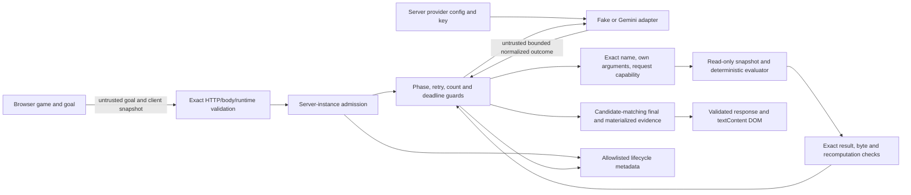

# Secure the Arcade — Week 8 evidence

## Scope and execution record

This document covers Wave A preparation and implementation, Isidora's Wave B, joint Wave C integration, and subsequent targeted corrections on `week8/secure-the-arcade`. The immutable W05 comparison baseline is `e0ef30a1eddc9583a9894b79e10d53424d9f0b2a`. Elena's pushed Wave A handoff is `caf46ef6cf198ff31e659d939f96ca0a00638357`; Wave C started from the pushed Wave B handoff `e41f8ca85dcb8b51e873a87b6c5deb114ff9215e` on 2026-10-27 (Europe/Budapest). Codex's Wave B/Wave C technical execution on Isidora's request is described in the later sections; the earlier Wave A record is separated below. Elena's own complete-path explanation for T051 and the joint spoken rehearsal for T055 remain open.

**Current technical status (2026-10-28):** The [final delegated checkpoint](#2026-10-28-final-delegated-technical-checkpoint) records the new metadata/context correction, 341/341 fake-only Node and 10/10 browser results, plus the user's approved T051/T055 **technical-scope** closure. Earlier open-status and 311/332/335/337 observations below remain historical. The original teaching task's personal explanation and real joint demonstration are still unverified.

The later evidence checkpoints are now concrete: Wave C integration/report `ace48bfc8179365cd48625662e59f2d2f2e699a1`, first T055 helper/result `fd7c58f3b52cfb8e1f93a7f57a93ef236757dc76`, and repeat result `b166651d492ddf516d70b4e0b3fd63b8040c4b9e`. The [commit-based report](docs/W08_COMMIT_REPORT.md) maps each revision to changed files, observed checks, actual AI contribution and remaining human work; Git history was inspected before preparing that report. The documentation update adds no new full-suite PASS claim.

## Elena — Wave A: priprema, implementacija i provjere prije primopredaje Isidori

**Vremenska granica i izvori.** Ovaj presjek završava na [Elena handoff commitu `caf46ef6`](https://github.com/elenakalajdzic0512/retro-ai-engineering-challenge/commit/caf46ef6cf198ff31e659d939f96ca0a00638357) od 2026-10-27 u 15:26:16 UTC+01:00. Polazni [W05 merge `e0ef30a`](https://github.com/elenakalajdzic0512/retro-ai-engineering-challenge/commit/e0ef30a1eddc9583a9894b79e10d53424d9f0b2a) već je imao Neon Breaker igru, Tactical Coach i tekstualni prikaz rezultata. T001 u [tadašnjem quickstart-u](https://github.com/elenakalajdzic0512/retro-ai-engineering-challenge/blob/caf46ef6cf198ff31e659d939f96ca0a00638357/specs/004-secure-the-arcade/quickstart.md) bilježi čist početni working tree, Node `v24.21.0`, npm `11.19.0`, `npm run typecheck`, `npm run build`, `npm run build:server` PASS i `npm test` **287 passed / 0 failed / 0 skipped**. To je **W05 before** zapis, ne rezultat W08 implementacije. Prvi sandbox pokušaj Node suite-a naišao je na lokalni listener `EPERM`; ista komanda je potom prošla uz odobren pristup. Razvojni zadaci **T001–T055** označavaju rad i zavisnosti; **T00–T17** su acceptance/test scenariji, pa checkbox nije zamjena za izvršen test.

**SpecKit i raspored.** [Planning commit `36f1143`](https://github.com/elenakalajdzic0512/retro-ai-engineering-challenge/commit/36f1143e40234d4d4b1ee1fcdf2c7757843751de) dodao je [specifikaciju](specs/004-secure-the-arcade/spec.md), [requirements checklist](specs/004-secure-the-arcade/checklists/requirements.md), [plan](specs/004-secure-the-arcade/plan.md), [research](specs/004-secure-the-arcade/research.md), [data model](specs/004-secure-the-arcade/data-model.md), [security boundary contract](specs/004-secure-the-arcade/contracts/security-boundaries.md), [quickstart](specs/004-secure-the-arcade/quickstart.md) i [tasks](specs/004-secure-the-arcade/tasks.md). Oni postavljaju lokalni/demo trust model, šest rizika, I1–I8, T00–T17 očekivanja, 2-active/5-per-60s granicu, fake-only dokaze i buduća P1/P2/P3 poređenja; u tom trenutku to su bili planovi. [Workflow commit `580ae55`](https://github.com/elenakalajdzic0512/retro-ai-engineering-challenge/commit/580ae550c562b8710c3a99dd3c452de5c5d7f925) dodao je T001 istorijski zapis i sekvencu **Wave A Elena → Wave B Isidora → Wave C Joint**. Elena je pripremila zajednički T002 fixture, a njegovo vlasništvo ostalo je `[Joint]` i Isidora ga je kasnije pregledala/koristila. Plan T002 fiksira iste ulaze i mjere za P1/P2/P3, nazive brojača, potpuno poređenje lokalnog game objekta i zabranu live Gemini-ja; ne tvrdi da su poređenja tada bila izvršena. Git autor/committer Wave A commitova je Elena; to ne dokazuje da je ručno napisala svaki red koda ili samostalno osmislila svaki test. Codex je pomagao u izradi koda, testova i dokumentacije, uz Elenino vođenje koraka i primopredaje zabilježeno u zadacima i handoff-u.

| Wave A zadatak / grupa | Konkretan rad do `caf46ef6` | Fajl ili kontrola; scenario | Tadašnji rezultat ili granica |
| --- | --- | --- | --- |
| T001–T003 | Sačuvan W05 baseline; pripremljen shared T002 fake-only/P1–P3 ugovor; pregledani HTTP, origin, credential i preview tokovi. | [Quickstart T001–T003](specs/004-secure-the-arcade/quickstart.md), [plan](specs/004-secure-the-arcade/plan.md); budući T00–T17. | Baseline 287/287; T002 očekivanja nisu tadašnji P1–P3 PASS; lokalni tok nema autentikaciju ni privatne server resurse. [Checkpoint `580ae55`](https://github.com/elenakalajdzic0512/retro-ai-engineering-challenge/commit/580ae550c562b8710c3a99dd3c452de5c5d7f925). |
| T005, T007–T008 | Direktni HTTP fake/counter/fake-clock/hold-release helpers; minimalni `@playwright/test` **dev** dependency, Chromium config i production-built preview + fake API + drugi kontrolisani origin. | `tests/tactical-api.test.js`, `tests/tactical-admission.test.js`, `playwright.config.js`, `tests/browser/tactical-security.spec.js`; T008 fixture. | Infrastrukturni smoke, još bez T04/T05/T16 sigurnosnog zaključka. [Commit `9e85883`](https://github.com/elenakalajdzic0512/retro-ai-engineering-challenge/commit/9e85883331c1eb77955babbc908d7a729333c295). |
| T009–T011, T016, T018 | T01/T02/T03 HTTP i T15: invalid JSON/type/domain, >4096-byte body, privilege fields, resource selektori i forged schema-valid snapshot; validan rubni request prolazi. Conditional T018 zatvoren provjerom postojećeg W05 ugovora, bez source izmjene. | `tests/tactical-api.test.js`, `tests/tactical-snapshot.test.js`; `server/index.ts`/`server/tactical/contracts.ts` validacija prije provider konstrukcije. | Fokusirano **17/17**, 0 failed; nevalidni input pravi 0 provider/tool rada. Forged state ostaje advisory, bez potvrđenog server score-a ili promjene lokalnog kanonskog game objekta. [Commit `293cc46`](https://github.com/elenakalajdzic0512/retro-ai-engineering-challenge/commit/293cc46d8966186177672eae48637c39b682570b). |
| T023–T026 | Negative-tests-first T13 concurrency/rate/lifecycle i T14 sintetička tajna/newline-fake-event. | `tests/tactical-admission.test.js`, `tests/tactical-api.test.js`, `tests/tactical-security-events.test.js`; T13/T14. | [Before-hardening `9799bbe`](https://github.com/elenakalajdzic0512/retro-ai-engineering-challenge/commit/9799bbe7b99d49b853a35c51073a4bdb611bd958): **1 pass, 4 TODO**, bez lažnog PASS-a; treći held poziv i šesti arrival tada dosežu provider, event sink još ne postoji. |
| T031–T034 | Uvedeni server-owned max 2 aktivna poziva, max 5 prijema u rolling 60 s, per-request lease i minimalni event sink sa generisanim correlation ID-om i ograničenim brojačima. | `server/index.ts`, `server/tactical/admission.ts`, `server/tactical/security-events.ts`; T13/T14 i realna HTTP putanja. | Fokusirano **5/5**, 0 TODO; 311/311 full fake-only Node na tadašnjem checkpoint-u. Lease se tada oslobađao po završetku agentskog toka; ograničenje u odnosu na nerazriješen provider koji ignoriše abort navedeno niže. [Commit `27ecfc7`](https://github.com/elenakalajdzic0512/retro-ai-engineering-challenge/commit/27ecfc7bc0cc400a9989ca9d34bb26248194e827). |
| T036–T037 | T04/T05 stvarni Playwright DOM: hostile final text, malicious goal kao model-context kanal, benigni dijakritici/apostrof/`a < b`, raw HTML, Markdown i `javascript:` ostaju inertni. | `tests/browser/tactical-security.spec.js`; postojeći W05 `src/tactical-ui.js` koristi `textContent`. | Fokusirano **6/6**, browser **7/7** prije CSP-a; nema produkcione UI izmjene. [Commit `afcf455`](https://github.com/elenakalajdzic0512/retro-ai-engineering-challenge/commit/afcf45518000b5e30ba4421a7f6cf3b844175c1d). |
| T038–T040 | Production preview `/api` proxy, CSP i `nosniff`/`no-referrer`; T16 kontrola dostupnog skripta, sintetički sentinel, build/source-map i normalan game/Coach smoke. | `vite.config.js`, `tests/browser/tactical-security.spec.js`; T16 kroz stvarni built browser. | T16 **2/2**, browser **10/10**; skript HTTP 200 radi bez CSP-a, na production stranici ga `script-src-elem` blokira; sentinel 0 u svježem `dist/`, `.map` fajlova nema. [Pre-handoff `c8c3a04`](https://github.com/elenakalajdzic0512/retro-ai-engineering-challenge/commit/c8c3a04c63d3f83f186e8ff4bb783fa2ad32ec38). |
| T043–T044 | Read-only audit lockfile-a i conditional odluka **T044 NOT APPLICABLE** za pregledani macOS/local-demo profil; bez upgrade-a ili audit fixa. | [Quickstart T043/T044](specs/004-secure-the-arcade/quickstart.md), `package-lock.json`; FR-015. | Full audit exit 1: **2 pogođena dev-graph paketska unosa** (`vite`, `source-map-js`); runtime-only exit 0/0 nalaza. Advisories nisu popravljeni. [Handoff `caf46ef6`](https://github.com/elenakalajdzic0512/retro-ai-engineering-challenge/commit/caf46ef6cf198ff31e659d939f96ca0a00638357). |

**Tehničke granice u tadašnjem toku.** Direktni POST `/api/tactical-coach` validirao je metod, JSON media type, tijelo do 4096 bajta i tačan `{goal,state}` prije konstrukcije providera/admission rada. Pojedinačno testirana `provider`, `maxSteps`, `ownerId`, `role`, `gameId`, `sessionId` i `scenarioId` polja nisu davala dodatnu privilegiju ili resurs. Interno konzistentan, ali falsifikovan client-reported Tactical snapshot mogao je biti pročitan samo kao nepouzdan savjetodavni ulaz: validacija nije dokaz odigrane partije ili server-authoritative score-a. T018 zato potvrđuje postojeći W05 boundary, dok su T031–T034 **nova W08 kontrola**. Per-process admission koristio je server clock i 429 bez provider/tool rada za odbijeni zahtjev; testovi su razlikovali rezervaciju mjesta od rolling rate timestamp-a, timeout/disconnect i kasne rezultate. Sintetički `W08_SERVER_SECRET_DO_NOT_EXPOSE` i zaseban newline/fake-event input nisu se pojavili u provjerenom HTTP/model/event izlazu niti su proizveli dodatni lažni događaj; ovo nije dokaz za svaki mogući secret ili log sink. Izvori su [handoff quickstart](https://github.com/elenakalajdzic0512/retro-ai-engineering-challenge/blob/caf46ef6cf198ff31e659d939f96ca0a00638357/specs/004-secure-the-arcade/quickstart.md) i gornji test/source commitovi.

**Browser i dependency granica.** Playwright fixture je koristio stvarni produkciono izgrađeni frontend, relativni same-origin `/api`, eksplicitni fake provider, kontrolisani drugi loopback origin i normalan Tactical UI DOM. T04/T05 su potvrdili **postojeći W05 text-only `textContent` prikaz** bez oslanjanja na CSP. T038 je zatim dodao novu W08 preview politiku `default-src 'self'; script-src 'self'; style-src 'self'; img-src 'none'; connect-src 'self'; object-src 'none'; base-uri 'none'; frame-ancestors 'none'`, uz `X-Content-Type-Options: nosniff` i `Referrer-Policy: no-referrer`. T039 je uporedio isti HTTP-200 skript na no-CSP control stranici i production stranici, gdje je ostao neizvršen uz imenovanu browser violation. T040 je provjerio normalnu igru, fake Coach, inertni hostile text i sintetičku tajnu u build/HTML/API/UI/event površinama; `dist/` search je imao 0 nalaza, a source maps nisu postojale. Audit je pokazao čist **runtime-only graph**, ali preostale nalaze u dev toolchain-u: `source-map-js@1.2.1` može biti relevantan pri obradi nepouzdanih indexed mapa, a Vite nalazi zahtijevaju ponovno razmatranje pri Windows/WSL, custom-middleware ili izloženom dev-server profilu. T044 N/A nije tvrdnja da su paketi sigurni ili advisory nalazi uklonjeni.

**Istorijska handoff provjera, ne novo izvršavanje.** [Quickstart na `caf46ef6`](https://github.com/elenakalajdzic0512/retro-ai-engineering-challenge/blob/caf46ef6cf198ff31e659d939f96ca0a00638357/specs/004-secure-the-arcade/quickstart.md) bilježi komande i sljedeće opažene rezultate na pre-handoff checkpoint-u [`c8c3a04`](https://github.com/elenakalajdzic0512/retro-ai-engineering-challenge/commit/c8c3a04c63d3f83f186e8ff4bb783fa2ad32ec38):

| Komanda ili izbor | Istorijski rezultat |
| --- | --- |
| `TACTICAL_AI_PROVIDER=fake node --test --test-name-pattern='^T(01|02|03|15)' tests/tactical-api.test.js tests/tactical-snapshot.test.js` | **17 passed**, 0 failed/skipped/TODO. |
| `TACTICAL_AI_PROVIDER=fake node --test --test-name-pattern='T13|T14' tests/tactical-admission.test.js tests/tactical-api.test.js tests/tactical-security-events.test.js` | **5 passed**, 0 failed/skipped/TODO; napredak od ranijeg **1 pass, 4 TODO** na `9799bbe`, ne zamjena za kasnija puna P1/P2/P3 poređenja. |
| `TACTICAL_AI_PROVIDER=fake npm test`; `npm run test:browser:w08` | **311 passed**, 0 failed/skipped/TODO; **10 browser passed**, 0 failed. |
| `npm run typecheck`; `npm run build`; `npm run build:server` | Sva tri PASS. |
| `rg --no-ignore --text --fixed-strings -n 'W08_SERVER_SECRET_DO_NOT_EXPOSE' dist`; `rg --files --no-ignore dist -g '*.map'` | Obje komande exit 1 bez izlaza: **0 sentinel nalaza** u tadašnjem svježem `dist/`; **nema source maps**. |
| `npm audit --package-lock-only --json`; `npm audit --package-lock-only --omit=dev --json` | Full exit 1 sa **2 dev-graph package entries**; runtime-only exit 0 sa **0 nalaza**. Nije rađen `audit fix`. |

Handoff `caf46ef6` je commitovan i pushovan na feature granu; [commit report](docs/W08_COMMIT_REPORT.md) ga identifikuje kao Isidorinu početnu tačku. Tadašnji završni status je prijavljen kao čist, ali sam Git commit ne može retroaktivno dokazati odsustvo lokalnih untracked fajlova. Fake-only tok nije zvao live Gemini niti koristio pravi API ključ. Dokazi važe za pregledani lokalni macOS profil i jedan Node proces; browser-supplied game state nije potvrđena serverska istina. Wave A T13 lifecycle testovi prošli su za tadašnje kontrolisane slučajeve, ali **nisu obuhvatili underlying provider promise koji ignoriše AbortSignal i ostaje nerazriješen nakon HTTP timeout-a/disconnect-a**. Taj naknadno otkriveni capacity gap ispravljen je tek u [commitu `a7b5c3a`](https://github.com/elenakalajdzic0512/retro-ai-engineering-challenge/commit/a7b5c3a4bbf630afa3ab40cb4a91e5b50457ce26); popravka i njeni testovi nisu dio Eleninog originalnog handoff-a. Wave B je preuzeo provider/tool granice i vlastite negativne testove, a Wave C zajedničke integracione dokaze i ljudske T051/T055 obaveze.

## Expectations written before Wave C evaluations

- T00: normal gameplay moves, then a fake Tactical request succeeds with at least two provider steps and one real allowlisted tool execution, both evidence sources and no complete canonical game mutation; Week 4 Hint also succeeds and gameplay can resume.
- P1: identical valid HTTP bytes and three held fake-provider requests on each revision. Measure, rather than assume, the baseline's third provider entry; after hardening expect peak two, rejection before provider/tool work, then successful capacity recovery. A separate rolling-window fixture checks rate expiry.
- P2: build both revisions from their source, use the same reachable control-script URL and no-CSP control, inspect actual delivered preview headers, execute the same injection and normal game/fake Coach smoke. Expect baseline header absence/resource execution if confirmed, and W08 script-src blocking with normal operation. Any proxy or harness adaptation must be identified.
- P3: same forged-valid snapshot, malicious goal, fixed fake `constructor`, `toString`, and `set_score` proposals, plus a positive allowed-tool control. Expect zero forbidden execution on both revisions; W05 need not be vulnerable. Compare complete canonical local game objects.
- Full matrix: execute existing T00–T17 checks without live Gemini or real keys, record actual command results/counters and applicability. Final typecheck, all Node tests, client/server builds, Chromium checks, sentinel scan and runtime/full dependency audit must be observed before declaring a technical pass.

This initial record contains expectations, not future PASS claims. Executed results, limitations, risk/data inventories and the task report are appended as checks finish. Human review/rehearsal will not be inferred from automated checks.

## Observed integration failure before correction

The first full Wave C suite passed 332/332. Its required repeat ran 332 tests with 331 passed and 1 failed: `T13 lifecycle`, disconnect subcase, observed `providerAbort=0` rather than 1 after the fixture's fixed 20 ms delay (`tests/tactical-admission.test.js`). Prior focused/matrix runs had passed. The test's client disconnect can precede server-side delivery of the close/abort event; a 20 ms wall-clock sleep is not a completion barrier. Expected correction: wait for the actual fake-provider abort and completion-event promises, preserve the exact one-abort/one-release assertions, then settle the late value and verify no extra completion. This is a narrow test-fixture correction justified by an observed integration failure, not a change to server policy. Its results are recorded below after execution.

**Observed correction result:** the fixture now waits for actual abort/completion gates rather than 20/10 ms sleeps. Focused admission checks passed 3/3. Two subsequent full runs each passed **332/332**, 0 failed/cancelled/skipped/TODO. The final selected Node security matrix passed **41/41**. No runtime protection, timeout value or assertion was relaxed. This is the only integration correction; the other Wave C changes add evidence, a positive integration test and test-only browser counters.

## Reproduction and verification results

Run from the repository root in Windows PowerShell. Use the locked installed toolchain (Node v24.21.0, npm 11.19.0, TypeScript 7.0.2, Vite 7.3.6, Gemini SDK 2.24.0, Playwright 1.64.1). `npm.cmd` avoids this machine's PowerShell restriction on `npm.ps1`. Chromium v1248 was installed during Wave B. No real key is needed; fixture-only sentinels are synthetic.

```powershell
$env:TACTICAL_AI_PROVIDER = 'fake'
$env:AI_PROVIDER = 'fake'
$env:GEMINI_API_KEY = ''
npm.cmd ci --no-audit --no-fund  # prerequisite if dependencies are absent
npm.cmd run build:server
git archive --format=zip --output=node_modules/.cache/w08-before.zip e0ef30a1eddc9583a9894b79e10d53424d9f0b2a
Expand-Archive -LiteralPath node_modules/.cache/w08-before.zip -DestinationPath node_modules/.cache/w08-before -Force
node node_modules/typescript/bin/tsc -p node_modules/.cache/w08-before/tsconfig.server.json
node tests/helpers/w08-compare.mjs node_modules/.cache/w08-before . docs/evidence/w08-comparison.json
node --test --test-reporter=tap --test-name-pattern='^T(?:0[0-9]|1[0-7])(?: |/)' tests/tactical-api.test.js tests/tactical-orchestrator.test.js tests/tactical-tools.test.js tests/tactical-gemini-provider.test.js tests/tactical-admission.test.js tests/tactical-security-events.test.js tests/tactical-snapshot.test.js
npm.cmd run typecheck
npm.cmd test
npm.cmd test  # required repeat for reproducibility, after the correction
npm.cmd run test:browser:w08  # includes client/server builds
npm.cmd audit --package-lock-only --json
npm.cmd audit --package-lock-only --omit=dev --json
git diff --check
git status --short
```

`node_modules/.cache/` must exist before using it for the archive/output (`New-Item -ItemType Directory -Force node_modules/.cache`). Archiving preserves the actual committed W05 source without switching branches or introducing vulnerable code. The same installed W08 toolchain builds both snapshots; the old lockfile is archived but its separate dependency graph is **not** installed. Therefore these are source/config comparisons under one controlled toolchain, not comparisons between two independently restored historical machines. The runner gives **both** Vite previews an explicit OS-assigned loopback fake-API proxy, since the original W05 config targets fixed port 3001. This test-only serving adaptation does not change either revision's headers or source. Script/control servers, previews, APIs and Chromium close in `finally`.

| Executed check | Actual result |
| --- | --- |
| SpecKit prerequisites / requirements checklist | Existing feature resolved; requirements.md 30/30, 0 unchecked. No extension hooks configured. |
| Initial focused T00 command (`^T00`, also matching two T005 helpers) | Exit 0; 3 passed. The official T00 itself passed with 3 Tactical attempts, 2 allowed tools, 0 forbidden, 1 Hint call. |
| Affected game/Hint/UI/API/provider integration selection | Exit 0; 236 passed, 0 failed/skipped/TODO. |
| Selected official Node matrix, before and after fixture correction | Exit 0; 41 passed on both selections. Browser-only IDs are executed separately below. |
| P1/P2/P3 comparison runner, two local executions | Exit 0 on both, same policy outcomes. The retained JSON is the second execution; ephemeral ports vary across runs, while each execution uses one identical script URL for both revisions. |
| Full Node suite after correction, run 1 / run 2 | Exit 0 / 0; **332 passed / 332 passed**, 0 failures/cancellations/skips/TODO. |
| Typecheck / server build / client build | Exit 0 for each; the final browser command also rebuilt client/server. |
| Final Chromium browser suite with explicit work/admission counters | Exit 0; **10 passed** in 11.1 s. Intended external-script CSP violation only; normal game/Coach and inert-text assertions pass. |
| Runtime audit | Exit 0; 0 vulnerability entries. See [raw snapshot](docs/evidence/w08-audit-runtime.json). |
| Full audit | Audit exit 1 **with findings**, not a clean pass: 2 affected development-package entries, high 2; see [raw snapshot](docs/evidence/w08-audit-full.json) and dispositions below. |
| Sentinel/artifact/source-map inspection | Synthetic server sentinel absent from fresh client artifacts; no client source maps present. T10/T14/T16 separately verify model/public/event surfaces. |
| Diff / dependency changes | `git diff --check` passes. No runtime, package, lockfile or application UI change in Wave C. Pre-existing untracked `.agents/skills/student-weekly-report/` is outside this task and excluded. |

Both initial sandboxed audit requests failed at registry access; the identical read-only commands completed with approved network access. Local esbuild/preview/browser work used approved access where the sandbox restricts parent-directory discovery. These environment restrictions are not recorded as application vulnerabilities. Logs used for this run remain ignored in `node_modules/.cache/w08-*`; durable observations are in this report and the committed JSON snapshots. The final documentation/test commit identifies the reproducible Wave C candidate; its SHA is reported after commit rather than fabricated inside its own contents.

## Architecture and actual policy



The model proposes; the application decides and executes. Neither client state nor model text grants authority. The two tools are `get_tactical_snapshot` and `evaluate_tactical_strategy`; there is no game mutation tool, authentication, private resource database, confirmed ranking or trusted match ledger.

Effective compiled exports and the checked non-exported boundaries are recorded in [w08-policy.json](docs/evidence/w08-policy.json). Values below are **observed in source/config and exercised by the named boundary tests**, not merely copied targets.

| Boundary | Effective value | Enforcement and observed proof |
| --- | ---: | --- |
| Tactical request body | 4096 UTF-8 bytes | `server/index.ts` body reader; oversized T02 rejection plus existing padded-4096 positive HTTP case. Week 4 separately retains 1024. |
| Goal | 240 Unicode code points | `parseTacticalRequest`; T01 240-point positive and existing contract length negatives. |
| Normalized provider outcome | 8192 UTF-8 bytes | Adapter and common orchestration check; T06 accepts 8192 at semantic boundary and refuses 8193/multibyte oversize. **Post-SDK**, not a network/SDK allocation cap. |
| Raw final `part.text` / retained `thoughtSignature` | 8192 / 8192 UTF-8 bytes | Raw text checked before `JSON.parse`; signature checked before retention and preserved exactly within limit. New T06 post-SDK tests cover ASCII/multibyte boundaries, oversized rejection and useful continuation. |
| Total model-facing Gemini request | 16384 serialized UTF-8 bytes | Adapter checks before every SDK call. Counts model, `contents`, system instruction and generation config with tool declarations or response schema; excludes transport signal/retry options. Normal requests measured 1053/2003/4360; exact 16384 accepted, 16385 rejected; combined individually valid signatures cannot bypass the total. |
| Tool result | 8192 UTF-8 bytes | `parseTacticalToolResult` and byte checker; T10 size edge and corrupt/secret results stop before next provider call. |
| Final plan / materialized success | 4096 UTF-8 bytes each | Contract and orchestration checks; existing plan/success oversized tests run in the full suite. |
| Logical steps / tool executions / provider attempts | 3 / 2 / 4 | Phase machine, tool check and reservation guard; T11 plus full retry regressions. No fifth call or third tool. |
| Transient retries / requested backoff | 1 / 100 ms | Shared `retryUsed` and bounded sleep; full retry tests and T11. |
| Provider per-call / total deadline | 5000 / 22000 ms | T12 manually fires both separate limits and settles late promises; total deadline is never reset. |
| Local synchronous tool budget | 100 ms | Existing tool-timeout test; total deadline checked around execution too. |
| Active / rolling admissions | 2 / 5 per 60000 ms | Compiled admission exports; P1/T13 held-run, separate rate/staggered expiry and lifecycle recovery checks. |
| Gemini maximum output tokens / SDK HTTP attempts | 2048 / 1 | Every stage's SDK config and actual installed-SDK mocked-fetch test; 4 app attempts equal 4 mocked HTTP calls. |

The normal controlled envelope remains 3 steps/2 tools, outcomes 70/157/331 bytes and materialized success 450 bytes (Wave B measurements rerun in the full suite). A 2048-token limit provides headroom over that compact example, without claiming a token-to-byte equivalence or universal live-model quality. The new signature/context checks are application-side; the SDK's received response can already occupy memory before they run.

## Same-input before/after observations

[w08-comparison.json](docs/evidence/w08-comparison.json) retains the actual counters, states and delivered headers. Both revisions received identical serialized normal input SHA-256 `1136905d7611d460da1c8aaf898ebcc61cbcaaffaed77dfcdcfeb37f21b43347` and identical forged-valid/malicious input SHA-256 `62eca91f445015d38fcc986e2ac7b6611c66e14ca5b9b0e42e7e8b4cd3e2dbe9`. The runner asserts those byte strings are equal, not just logically similar.

| Comparison | W05 baseline observed | W08 observed | Conclusion and limit |
| --- | --- | --- | --- |
| **P1 / T045 — three held valid requests, then recovery** | Peak held provider runs **3**; third enters provider (1 initial attempt, 0 tools while held); statuses including recovery **200/200/200/200**; completed totals **12 attempts / 8 tools**. No server admission ledger: N/A. | Peak **2**; third starts **0 attempts / 0 tools**, HTTP **429**; statuses **200/200/429/200**; totals **9 attempts / 6 tools**. Actual held admission `{activeRuns:2,admittedRuns:2,releasedRuns:0}`; after recovery `{0,3,3}`. | New server gate reduces local simultaneous work and recovers after a slot releases. Counts distinguish held provider entry from server-owned slots. Single process only; separate rate proof below. |
| **P2 / T046 — same reachable script URL and normal built app** | Delivered CSP/nosniff/referrer headers absent. Script marker **true**, no CSP violations. Normal Coach **3 attempts / 2 tools**, game launches. | CSP/nosniff/no-referrer present. Script marker **false**, named **script-src-elem** violation for the same URL. Normal Coach **3/2**, game launches. | New delivered policy blocks an otherwise executable resource without breaking the tested app. Identical HTTP-200 control script executes on the separate no-CSP page on both runs. Test-only proxy adaptation described above; no deployment-host claim. |
| **P3 / T047 — constructor, toString, set_score and positive control** | Each hostile case HTTP **502**, **1 attempt / 0 tools / 0 forbidden**. Unknown names map to `unknown_tool`, `set_score` to `forbidden_tool`. Positive **200, 3/2/0**. | Identical safe outcomes and counts. | Existing W05 exact dispatch remains effective. This is regression proof, not a newly fixed exploit or evidence about universal Gemini prompt immunity. |

In the retained P2 run the shared controlled URL was `http://127.0.0.1:61480/w08-control.js`. It returned HTTP 200 with JavaScript content type and the marker bytes; the no-CSP control executed it. W08 blocked that exact URL under configured `script-src 'self'`, reported as the browser's effective `script-src-elem`. Delivered policy was `default-src 'self'; script-src 'self'; style-src 'self'; img-src 'none'; connect-src 'self'; object-src 'none'; base-uri 'none'; frame-ancestors 'none'`, with `X-Content-Type-Options: nosniff` and `Referrer-Policy: no-referrer`. This is not a 404/MIME/network-failure proxy for CSP.

P3 compares the **entire locally held canonical game** before/after each call, with no changed paths. Its digest on both sides is `ea8a73a12c09c7ef65acc24566dda423964dbd9903081469be940ba7fe0b443c`. The incoming forged snapshot is internally valid (playing, score 10, 39 remaining bricks with corresponding zone/normal count), while the canonical local fixture stays ready, score 0, lives 3, 40 alive bricks. This does not authenticate another caller's game history.

Separate T13 rate results: five valid arrivals at fake time 1000 ms succeed; sixth is 429 with 0 constructions/attempts/tools; an invalid request consumes no admission; at +60001 ms a valid request succeeds. Across the two windows there are **6 admitted, 18 attempts, 12 tools**; final current-window admission is 1. Staggered timestamps prove per-arrival rolling expiry rather than a fixed minute bucket. Success/error/timeout/cancellation/disconnect/late-settlement each release once, and every recovery probe returns 200.

## Official T00–T17 matrix

The table below retains the original 41-case Node and 10-case Chromium matrix, supplemented at that time by the 332-test suite. The 2026-10-28 checkpoint adds the abort-ignoring T12/T13 and metadata/context T06 evidence; it does not retroactively turn the original fixtures into tests they did not run. A table row can cover multiple subcases and some shared tests cover two IDs; it is not a claim of 18 separately numbered test functions. `A/T/F` below means actual provider attempts / executor entries / forbidden executions. Unit-only cases have **N/A admission** because they do not enter HTTP; state N/A means that row does not hold a canonical game. Central counters and state assertions are explicitly retained.

| ID / fixture and expected boundary | Observed work, admission and result | State before/after, conclusion and proof limit |
| --- | --- | --- |
| T00 — `T00 normal gameplay...` HTTP integration; legitimate plan and Hint | HTTP 200; **A/T/F 3/2/0**, 1 admission/release, active after 0; Hint provider call 1. Both evidence sources materialized. | Game launches/moves before coaching and resumes after. Complete before/after digest **46d3a31667c08b7145a4520b8260365373a1b8d71cb35659e22055aabc33dbdf**, deep equality and empty changed paths across Coach/Hint. Local canonical fixture, not a remote-history guarantee. |
| T01 — invalid JSON, wrong goal/lives types, domain-invalid count/score; valid 240-point control | Each invalid **0/0/0**, no provider construction/admission, safe 400. Legitimate boundary control **3/2/0**, HTTP 200. | State N/A for invalid HTTP bytes. Runtime request validation protects provider work, not caller authentication. |
| T02 — separate >4096-byte body and well-sized provider/maxSteps/ownerId/role fields; normal control | Oversize 413; field cases 400; each **0/0/0**, no admission/provider construction. Normal **200, 3/2/0**; padded 4096-byte body positive in full suite. | State N/A; extra client fields cannot select server policy. Distinct cases prevent size rejection from masking privilege validation. |
| T03 — gameId/sessionId/scenarioId/resourceId and two-context tool fixtures | HTTP selectors each **0/0/0**, no admission; tools reject copied foreign capability before evaluator entry. Correct current-context call succeeds (1 evaluator entry); foreign schema-valid evaluation fails recomputation. | Two copied/frozen snapshots remain lives 3 and lives 1 respectively; original mutation does not alter context. Tool-only provider/admission N/A. Local capability scope, not auth or real foreign-resource storage. |
| T04 — real browser malicious fake final, actual goal channel, benign Serbian/apostrophe/`a < b` | Each submitted flow measures **3/2/0**, active after 0/current-window admitted 1. Script marker false, no attacker element; benign text readable. | Browser closure's canonical object is not exposed; N/A direct full-state measurement here, supplied by T00/T09/T17. Goal reaches model context but is not itself reflected as a result DOM sink. Actual text-only rendering proof. |
| T05 — raw HTML, Markdown, javascript URL/link | Per fixture **3/2/0**, active after 0/admitted 1; no HTML conversion, active anchor, navigation or script marker. | Full canonical state N/A browser text test. Proves these tested strings remain inert, not every future rendering implementation. |
| T06 — invalid decision/final and byte-bound outcomes in orchestrator/SDK stub | Original: invalid decision **1/0/0**; invalid final **3/2/0**. At 8192 bytes semantic validation is reached; 8193/multibyte oversize stops first. Tool-name oversize **1/0/0**; final oversize **3/2/0**. New checkpoint: 100000-byte-class signature stops after **1 SDK attempt/0 tools**, valid 8192-byte signature preserved, 8194 rejected; combined context stops before third SDK call, total 16384/16385 edge measured. | Admission/state N/A for adapter units; separate HTTP oversized-signature case returns sanitized 502 and no raw signature in default event lines. All checks are post-SDK; final schema validation remains. [Final checkpoint](#2026-10-28-final-delegated-technical-checkpoint). |
| T07 — missing/constructor/toString/set_score, direct tools and orchestrator | Hostile proposals **1/0/0** each; direct evaluator spy 0. Positive control **3/2/0** or 1 direct evaluator entry. | Canonical game from `createGame()` deep-equal before/after hostile run. Unit admission N/A. Exact allowlist, not prototype-based dispatch. |
| T08 — invalid/extra/inherited/accessor args; schema-valid copied foreign context; same allowed tool positive | Invalid args and copied foreign capability cause 0 evaluator calls, getter count 0; current context succeeds with 1. Provider/admission N/A for direct tool tests. | Snapshot remains request-scoped/frozen; same shape alone gives no capability. Does not claim resistance to trusted server code deliberately constructing another context. |
| T09 — malicious goal observed by scripted fake before forbidden proposal | Fake records exact goal, **1/0/0** for each forbidden/prototype proposal; useful positive flow remains **3/2/0**. | Full canonical local game deep-equal before/after. Unit admission N/A. Application execution-policy proof, not real-model prompt immunity. |
| T10 — invalid shape, oversized result, extra envelope/nested synthetic secret | Each negative **1/1/0**, stops before any next model call; no raw invalid object/secret in context. Positive **3/2/0**, prior results 0/1/2. Standalone UTF-8 checker accepts 8192, rejects 8193. | Admission/state N/A unit result boundary. Executor entry is counted even when its output is rejected. Fixed valid schemas cannot naturally reach the byte maximum, so checker and injected-shape tests are separate. |
| T11 — repeats, phase/step/tool limits, total attempts and one transient retry | Useful retry path **4/2/0**, prior contexts 0/1/1/2; one 100 ms sleep. Third tool refused after 3 attempts/2 entries; wrong phase stops before its execution. Duplicate tracker refuses repeat, fifth reservation refused before work; prior retry negatives stop a second retry. | Admission/state N/A budget units. Phase machine makes a fourth logical step unreachable; reservation test does not pretend a fifth actual network request happened. |
| T12 — separate per-call and aggregate timeout; late results | Original: two 5000 ms expiries **2/0/0**, late proposals no tool; total attempt starts 0/7500/12400/17300 ms, final timeout 4700, **4/2/0**, deadline 22000. Later abort-ignoring timeout/retry regression retains the unresolved provider job and starts no overlapping retry; a settled transient failure still permits legitimate retry. | Unit admission/state N/A for original cases; later real HTTP cases keep response prompt while capacity remains reserved until actual local settlement. No proof of remote stop/billing. [Correction checkpoint](#2026-10-28-targeted-technical-correction-checkpoint-observed-before-commit). |
| T13 — concurrent/rate/lifecycle HTTP subcases | Original P1 cap/recovery **9/6/0**, peak active 2, excess **0/0/0**; separate rate **18/12/0** over 6 admissions. Later HTTP tests include abort-ignoring late resolve/reject, synchronous throw and retry; actual in-flight provider jobs stay ≤2, lease releases once after settlement and legitimate recovery succeeds. | Canonical state N/A admission fixture; P3/T00 prove no mutation separately. Single server instance; no distributed quota/fairness claim. The timing fixture failure and later capacity correction are both preserved. [Correction checkpoint](#2026-10-28-targeted-technical-correction-checkpoint-observed-before-commit). |
| T14 — synthetic internal error and separate newline/fake-event sink | Internal error uses **2/0/0** (one shared retry); no sentinel in next context/HTTP. Newline/event case **1/0/0**, exactly 2 captured and 2 default operational records, 0 forged events. Completion counts are bounded. | State N/A; each HTTP run admitted once, no tool. Correlation ID is generated and does not equal attacker header. App event/public boundaries only, not third-party infrastructure logs. |
| T15 — forged but valid client snapshot and genuine positive request | Forged **3/2/0** then genuine **3/2/0**, 2 total admissions; no returned confirmed score/privilege or changed budgets. | Canonical initial game score 0/lives 3/40 alive stays fully deep-equal; forged playing score 10/39 bricks differs only in advisory request. Valid schema does not prove actual play. |
| T16 — fresh build, sentinel, exact headers and reachable-script control | HTTP-200 control executes with no CSP; production marker false plus script-src-elem violation. Normal P2 Coach **3/2/0**; final browser hostile helper measures **3/2/0**, active after 0/admitted 1. Sentinel 0 in client/HTTP/UI/events; maps absent. | Game ready state/CSS and launch smoke work. Full canonical object N/A in browser closure. Local built preview only, not a production internet deployment or a raw-SDK byte cap. |
| T17 — forged-valid state plus malicious goal/newline, forbidden fake proposal and minimal event | HTTP 502 `forbidden_tool`; **1/0/0**, one forbidden proposal, 1 admission, active after 0. Exactly admitted/completed events, failed completion with counts 1/0, no raw content/secret or forged event. | Full canonical initial game score 0/lives 3/40 alive deep-equal before/after; caller's forged score 10/39-brick snapshot remains advisory. Connects HTTP/admission/model/dispatch/state/events beyond isolated T09/T14/T15. Local fixture, not authenticated game history. |

Invariant coverage: **I1** T01/T02/T13; **I2** T02/T03/T15/T17; **I3** T03/T07–T11/T17; **I4** T00/T09/T15/T17; **I5** T04/T05/T16; **I6** T02/T06/T10–T13; **I7** T10/T14/T16/T17; **I8** T00, T13 recovery, T16 and existing Hint/game regressions. No official technical row is unrun.

**I6 later reinforcement:** T06's raw-text and metadata/total-context regressions cover boundaries absent from the original 41-case matrix. T12/T13's later real-HTTP abort-ignoring, retry, late resolve/reject and exact lease-release cases cover actual local work after an HTTP timeout. Those additions passed in the final 341-test suite; the earlier matrix counts remain tied to their original checkpoint.

## Threat model: six architecture-specific risks

Likelihood/impact below are **qualitative judgments**, not measured attack frequencies. Priorities are R4, R3, R2: aggregate work was a missing directly reachable control; browser execution has high impact and needed delivered-policy proof; model-to-tool dispatch is the core AI capability boundary. R5 remains high-impact and is explicitly covered by result/event/sentinel work.

### R1 — direct HTTP / client privilege selection

- **Path/prerequisite/boundary:** caller can reach loopback API and bypass the browser with malformed JSON or extra provider/maxSteps/role/owner fields; untrusted HTTP bytes cross into server policy. **Asset:** provider budget and server configuration. **Likelihood high** because direct HTTP is trivial once reachable; **impact medium–high** if validation can start work or select policy.
- **W05 control / W08 gap:** bounded body and exact runtime request parser existed; the zero-work negative/positive matrix needed explicit proof. **Enforcement:** `handleTacticalCoachRequest` parses before admission/provider factory; no new login or authority field.
- **Executable evidence/result:** T01/T02 in `tests/tactical-api.test.js`, selected matrix command above; invalid cases 0/0 provider/tool work, valid boundary reaches 200/3/2. **Conclusion:** existing boundary confirmed, no conditional HTTP correction required.
- **Residual:** valid direct callers are still allowed subject to aggregate quota. Validation and CORS are not authentication.

### R2 — forbidden tool / cross-request context escalation

- **Path/prerequisite/boundary:** malicious goal or provider proposes prototype/unknown/mutation tool, wrong phase, extra args or copied foreign snapshot capability; model-controlled name/arguments cross into execution. **Assets:** canonical game and request-scoped data. **Likelihood medium–high** because proposals are untrusted; **impact high** if arbitrary capabilities execute.
- **W05 control / W08 gap:** exact two-name dispatch, phase/own-argument checks, WeakSet context, immutable snapshot, evaluator recomputation and repetition guards existed; malicious-goal/context/prototype and combined proofs were missing. **Enforcement:** `tools.ts`, `orchestrator.ts`, unchanged for these controls.
- **Executable evidence/result:** T03/T07/T08/T09/T11/T17 plus P3 runner; 0 forbidden executions, full game equality, current-context positive works on both revisions. **Conclusion:** preserved application policy, not a newly invented vulnerable W05 outcome.
- **Residual:** no universal real-Gemini injection-immunity claim, no authenticated private resource model, and trusted server extensions still need review.

### R3 — model/browser content execution

- **Path/prerequisite/boundary:** hostile user/model natural-language strings contain HTML, Markdown or javascript links; response text crosses into DOM/navigation. **Asset:** player browser execution context. **Likelihood medium** because free text reaches display; **impact high** if it becomes executable.
- **W05 control / W08 gap:** exact response parsing and `textContent` existed; delivered production preview CSP/headers and real-browser evidence were absent. **Enforcement:** unchanged `src/tactical-ui.js` text rendering plus W08 `vite.config.js` preview header policy.
- **Executable evidence/result:** T04/T05/T16 and P2; hostile text inert, normal letters readable, reachable second-origin script executes before and is blocked after by script-src-elem, normal game/Coach work. **Conclusion:** text-only control preserved and layered delivered-policy gap closed for the tested profile.
- **Residual:** local Vite preview is not a public production host; future rendering/assets/hosting changes require the same tests and header review.

### R4 — aggregate and per-run resource exhaustion

- **Path/prerequisite/boundary:** reachable caller starts parallel or frequent valid HTTP runs; provider emits oversized data, retries or settles late. Arrivals/model output cross server capacity/deadline boundaries. **Assets:** provider cost, server memory/time and responsive app. **Likelihood high** for reachable port; **impact medium–high** for unbounded aggregate work.
- **W05 control / W08 gap:** 3/2/4 steps/tools/attempts, 5000/22000 ms deadlines, tool/final bounds existed; aggregate admission and normalized-provider/output-token policy were missing. **Enforcement:** `admission.ts`, HTTP lease lifecycle, shared provider byte helper and Gemini generation/retry config.
- **Executable evidence/result:** P1 and T06/T10–T13; peak falls 3→2, excess starts 0 work, separate rate expiry and every lifecycle recover; provider cap rejects oversize; installed SDK performs one fetch per app attempt. **Conclusion:** bounded local admission/output and preserved per-run budgets.
- **Residual:** quotas are per-process, with no distributed coordination or per-user fairness. The SDK can receive/allocate large raw data before post-SDK checks; token count is not bytes. Scheduling stalls count toward absolute deadline.

### R5 — secret / operational log disclosure or forgery

- **Path/prerequisite/boundary:** internal exception, extra tool field, server key sentinel or newline/fake-event string reaches HTTP/model/browser/log. **Assets:** server configuration secrecy and trustworthy event records. **Likelihood medium** since errors/free text occur naturally; **impact high** for a real secret or forged record.
- **W05 control / W08 gap:** server-only key lookup, exact tool/final schemas and fixed public errors existed; minimal lifecycle event boundary and end-to-end sentinel/browser proof were absent. **Enforcement:** exact result parsers, fixed error mapping, allowlisted `security-events.ts`, no request/exception serialization.
- **Executable evidence/result:** T10/T14/T16/T17 and artifact scan; extra secret result stops before next model call, 0 sentinel occurrences outside test-allowed configuration, exactly real lifecycle events and no forged event. **Conclusion:** tested app-owned surfaces exclude unnecessary raw data.
- **Residual:** synthetic values establish tested data flow only; unobserved SDK/provider/host logging and future telemetry are outside this sink. No real key was used or scanned from private local environment files.

### R6 — forged client state promoted to confirmed authority

- **Path/prerequisite/boundary:** caller submits an internally consistent but unplayed snapshot/score; browser-controlled functional input crosses into advice and could be misinterpreted as server truth. **Assets:** game state and future ranking/privilege semantics. **Likelihood high** because client data is editable; **impact low now** for read-only advice, **high if reused as authority later**.
- **W05 control / W08 gap:** exact ranges/count equations, request-frozen snapshot and read-only tools existed; forged-valid/combined evidence was missing. **Enforcement:** request/snapshot contracts; no ledger or privilege use is implemented.
- **Executable evidence/result:** T03/T15/T17/P3; score 10/39-brick advisory input is accepted when valid but changes no server policy/confirmed result, forbidden action executes 0 times, full local game remains score 0/lives 3/40 alive. **Conclusion:** validated input remains unverified and advisory.
- **Residual:** the server cannot prove that a match was played. Authentication/authoritative game simulation would be separate work, not claimed by these tests.

## Data inventory and retention

Retention descriptions concern the inspected application, not guarantees about remote provider policy or the user's terminal history. Temporary test reports are intentionally retained as development evidence; operational events exclude raw functional input.

| Datum / controller | Boundary and validation | Model exposure | Storage/retention and necessity |
| --- | --- | --- | --- |
| Goal / browser user | Browser→HTTP exact `goal,state`; trimmed nonblank ≤240 code points | Yes, as goal text | Request and bounded adapter history; current form/UI until navigation/edit. Needed for coaching; never raw operational log. |
| State / browser game | HTTP snapshot parser→copied/frozen tool context | Validated snapshot via read-only tool result; Gemini initial message excludes raw request.state | Request scope, browser in-memory game. Functional input only, not ledger. |
| Score/lives/bricks/zones/ball/shield/portal / browser | Exact fields, ranges and count/score equations | Necessary bounded tool fields | Request scope; selected fact values materialized into advice. No confirmed ranking or privilege. |
| Provider/mode/model / server configuration | Fixed server factory and model constant; extra browser selectors rejected | No browser-selected provider; tool declarations supplied by app | Process configuration and per-run client. Needed for deterministic server policy. |
| API key / server environment | Server adapter construction only | No prompt/model-visible key | Process environment/client memory; no app persistence or public output. Tests use empty or explicitly synthetic value only. |
| Synthetic sentinel / test harness | Controlled environment/error/extra-field injection | Must not enter next context | Test source/evidence names deliberately retained; not a real credential. Detects boundary leakage. |
| Provider output / fake or remote | Adapter normalization→byte check→orchestration phase/schema | Only validated continuation is retained in adapter history | Per-run history; raw SDK response may already be allocated post-receive. Never raw operational event. |
| Gemini `thoughtSignature` / SDK response | Tool-call part type and ≤8192 UTF-8 bytes before retention | Replayed exactly in bounded next `contents`; never browser-visible | Per-run adapter history until completion. The full serialized model-facing request is checked at ≤16384 bytes before each SDK call; post-SDK checks do not cap inbound network/SDK allocation. |
| Tool name / model | Exact two-name registry and expected phase | App declarations and validated function-call history | Run scope; no arbitrary shell/URL/file/game-write capability. |
| Tool arguments / model | Exact own data fields; enums; no context/resource selector | Validated arguments in SDK history | Run scope; only bounded strategy candidate necessary for evaluation. |
| Tool result / app executor | Envelope/schema/8192-byte/recomputation before forwarding | Yes, only after validation | Run scope and bounded adapter history. Invalid/extra-secret object is not forwarded. |
| Final plan / model | Candidate match, exact schema/prose/reference/4096-byte checks | No next model step | Current HTTP response/UI until replaced or navigated away. Natural language remains untrusted inert text. |
| Materialized evidence / application | Allowed references and values from validated tools | No next model step | Response/current UI. Values are not model-authored assertions. |
| Public error / application | Fixed code/message map | No | HTTP/UI state; terminal tests may retain sanitized result. No raw exception/stack or private payload. |
| Correlation ID / application | Generated UUID; never client header as authority | No | Request + emitted event. Joins lifecycle records, not identity/auth. |
| Security event / application | Explicit event/time/ID/reason/outcome/counter allowlist | No | Default stdout sink; application sets no external retention/deletion policy. No raw goal/state/provider/key/token/CoT/stack. |
| Admission time/counters / server instance | Injectable server clock and atomic synchronous reserve/release | No | Memory until process ends; timestamps pruned after rolling 60000 ms. Capacity policy, not identity. |
| URL / browser/server route | Relative fixed `/api` and loopback upstream; unknown selector fields rejected | No arbitrary URL | Page/request URL only; no model-controlled remote fetch. Test URLs are local controlled resources. |
| localStorage/sessionStorage / browser | No such usage observed by source search in src/server route | No | No Tactical persistent browser storage observed; no invented stored session. |

## Origin/CSRF and dependency assessment

Actual serving profile: browser relative `/api` stays same-origin through explicit preview proxy to loopback Node. Inspected Tactical fetch/route has no login, cookie/session, bearer/Authorization privilege or resource-owner store. Broad CORS is not enabled; it is not authentication. **Privileged CSRF mechanism is not applicable to this observed credential-free advisory route**, a conditional architecture finding, not protection from direct resource abuse. Server admission remains required. Reassess before adding ambient privileged credentials or separate cross-origin deployment.

Runtime-only audit completed with 0 findings. Full lockfile audit completed with **source-map-js@1.2.1** (transitive development via Vite 7.3.6→PostCSS 8.5.28) and **vite@7.3.6** (direct development), aggregating the advisories below. The root runtime dependency is Gemini SDK 2.24.0, with no advisory in this audit. No package or lockfile changed, and no audit fix/update was run. Dispositions below concern this Windows/local-preview run; Elena's earlier macOS assessment is preserved historically and is not silently transferred.

| Advisory / severity | Package/classification and exposure | Disposition and remaining risk |
| --- | --- | --- |
| [GHSA-68fv-2mgg-jv7q](https://github.com/advisories/GHSA-68fv-2mgg-jv7q), high | source-map-js 1.2.1, transitive dev; malicious indexed source-map offsets may consume event loop. Current build consumes trusted repo input, not an exposed map-upload feature. | **Mitigated input boundary; still vulnerable/unfixed.** Developer/CI processing of untrusted maps remains open. Historical available fix 1.2.2; this audit reports a fix available without applying it. |
| [GHSA-698v-4r3x-3vcv](https://github.com/advisories/GHSA-698v-4r3x-3vcv), moderate | Vite 7.3.6 dev, Windows launch-editor escaping; this machine is Windows. Tests run built loopback preview and do not invoke editor launch. | **Accepted/open for Windows development tooling**, not called inapplicable by OS. Separate remediation/reassessment needed before an exposed/editor workflow; historical patch 7.3.7. |
| [GHSA-r825-w8mm-5pxw](https://github.com/advisories/GHSA-r825-w8mm-5pxw), moderate | Vite 7.3.6 dev, editor CLI arguments; this run does not invoke editor/WSL routes. | **Not exercised here; accepted/open if editor/WSL workflow is used.** No broad claim that all Windows setups are safe; historical patch 7.3.7. |
| [GHSA-587h-7wmj-h5pm](https://github.com/advisories/GHSA-587h-7wmj-h5pm), high | Vite 7.3.6 dev, Windows launch-editor existence-check bypass. | **Accepted/open Windows tooling risk**; no exploitability test or fix claimed, preview scope only; historical patch 7.3.7. |
| [GHSA-9jrq-w75r-8gcw](https://github.com/advisories/GHSA-9jrq-w75r-8gcw), low | Vite 7.3.6 dev, custom middleware/transformIndexHtml prerequisites absent from inspected stock SPA/preview config. | **Demonstrated not applicable to the inspected configuration**, not fixed. Adding that middleware requires reassessment; historical patch 7.3.7. |
| [GHSA-rq7h-c2jc-7f22](https://github.com/advisories/GHSA-rq7h-c2jc-7f22), moderate | Vite 7.3.6 dev, non-Windows filesystem/dev-serving prerequisites in returned advisory; current Windows run uses loopback built preview. | **Not applicable to this specific tested serving profile**, not fixed; exposed development topology/path collisions elsewhere require reassessment; historical patch 7.3.7. |

Package audit severity counts describe affected package entries, not the number of advisories or a proof of application security. The full audit is intentionally reported as findings/open risk; runtime cleanliness does not waive developer-machine risk. Wave C permits only demonstrated integration corrections, so this run preserves the locked graph and records the separate tooling work rather than claiming an unperformed upgrade.

## Contributions, reviews and remaining human work

- **Elena, prior Wave A:** prepared the sequential handoff and shared T002 fixture, guided the HTTP/admission/browser/dependency lane, reviewed its recorded gates and handed it to Isidora at [`caf46ef6`](https://github.com/elenakalajdzic0512/retro-ai-engineering-challenge/commit/caf46ef6cf198ff31e659d939f96ca0a00638357). The [Wave A evidence section](#elena--wave-a-priprema-implementacija-i-provjere-prije-primopredaje-isidori) ties all 26 Elena/shared-preparation tasks to historical commits, tests and limitations. Codex-assisted production/test/document work is not presented as Elena's unaided manual authorship or a new personal review.
- **Isidora's Wave B via Codex:** pushed provider byte/token/retry policy, tool/orchestrator negatives, combined T17 and T052 review note in `e41f8ca85dcb8b51e873a87b6c5deb114ff9215e`. T002 was prepared by Elena and reviewed/reused by Codex on Isidora's behalf. This is AI-assisted execution, not a claim of independent human review.
- **Wave C via Codex, requested by Isidora:** added T00, browser work/admission counters, same-source P1/P2/P3 runner and durable observations; corrected the demonstrated disconnect test race; executed matrix/regressions/build/audit checks; wrote this evidence and the exact eight-minute runbook in quickstart. No runtime feature, new dependency, auth or broad refactor was added.
- **T052 review transferred:** reviewed Elena's T01 malformed-JSON test and HTTP enforcement before admission/provider construction. Invalid input starts zero work and yields a fixed safe error; positive control succeeds. Proof limit: selected parser cases are not authentication or exhaustive input coverage. Full path: browser→HTTP validation→admission→bounded provider→closed read-only tools→validated results/final→materialized evidence→text-only UI, with minimal events and lease release.
- **T051 historical and amended status:** the earlier packet and AI-assisted T03/T08 review are recorded below. The final delegated technical recheck is now recorded in the [final checkpoint](#2026-10-28-final-delegated-technical-checkpoint); Elena's personal complete-path explanation remains unverified.
- **T055 historical and amended status:** two paced technical dry runs were recorded, followed by a final no-wait command/teardown verification in the [final checkpoint](#2026-10-28-final-delegated-technical-checkpoint). Neither a real two-person spoken rehearsal nor both humans' explanations have been observed.

### Step-by-step task report

| Task | Work completed and evidence | State |
| --- | --- | --- |
| T035 | Added official full-game/Coach/Hint positive integration, actual 3/2/0 work and complete state equality. | Complete |
| T041 | Reran affected 236-test selection, T00/full suite and browser checks; repaired only the observed test-fixture race, no UI/runtime correction. | Complete |
| T045 | Same-byte W05/W08 held-request comparison, actual peak/admission/work/status/recovery JSON. | Complete |
| T046 | Same script/control URL on original built configs, actual headers/marker/CSP directive and working game/Coach; proxy adaptation disclosed. | Complete |
| T047 | Same forged-valid malicious input, three forbidden/prototype proposals and allowed positive, complete game comparison on both. | Complete |
| T048 | Executed all T00–T17 technical rows, 41 selected Node checks plus 10 browser checks and full regressions. | Complete |
| T049 | Architecture, actual policy, data inventory, six concrete risks, priority and invariant mapping in this report. | Complete |
| T050 | Recorded real handoffs/contributions, comparisons/matrix, origins, audits, sentinel proof, failures/limitations and results. | Complete |
| T051 | Earlier and final Codex T03/T08 review, positive/negative proof and full-path preparation recorded; Elena's personal explanation unverified. | **Delegated technical complete; original human criterion open** |
| T053 | Reviewed intended test/evidence diff, app-owned secret surfaces, fixed errors, dependency graph unchanged and scope; unrelated local skill excluded. | Complete |
| T054 | Typecheck/builds, two corrected full runs, final matrix/browser checks, artifact scan and current full/runtime audits, with actual exits/findings. | Complete |
| T055 | Exact runbook, two historical paced technical runs and final no-wait command/teardown verification recorded; pair speech unverified. | **Delegated technical complete; original human criterion open** |

### T051 AI-assisted technical cross-review (2026-10-28)

Reviewed commit `a7b5c3a4bbf630afa3ab40cb4a91e5b50457ce26`, Isidora-owned `T03/T08 two request contexts stay isolated; a schema-valid foreign context is not a capability` in `tests/tactical-tools.test.js:200–225`, `server/tactical/tools.ts:83–87,107–112,160–187`, and the context creation/dispatch in `server/tactical/orchestrator.ts:319–326,375–389`. The negative calls use valid empty snapshot arguments and a valid candidate; the positive call with the same candidate succeeds, so invalid arguments do not mask the context check. A structured clone of another run's server-created context has a schema-valid snapshot but lacks the original object's WeakSet identity. Both calls with that clone return `invalid_input`, the injected evaluator is called zero times, and the source context's snapshot remains unchanged. The legitimate `runA` evaluation succeeds and increments the evaluator once; both genuine contexts return their own snapshot values. A valid evaluation from `runB` substituted into `runA` is rejected by deterministic recomputation.

Command: `TACTICAL_AI_PROVIDER=fake node --test --test-name-pattern='^T03/T08 two request contexts stay isolated; a schema-valid foreign context is not a capability$' tests/tactical-tools.test.js` → exit 0; **1 passed, 0 failed, 0 skipped**. No real key or live provider was used. Finding: **PASS for this tested object-provenance and request-context boundary; no implementation defect observed**. The forbidden effect is tool evaluation using a copied, unregistered context. The model supplies tool name/arguments, while the orchestrator creates the context from the current request and passes that local reference to the executor; no model field selects another genuine context. The direct tool function would accept any genuine server-created context passed by trusted caller code, so the clone test alone does not prove correct caller binding, identity of a human/game session, authentication, authorization, or that client-reported game state reflects actual play. These limits remain explicit. **Tehnički pregled izvršio Codex na Elenin zahtjev.** Elena's own explanation of the browser → HTTP → provider → tool → validated UI path has not occurred; T051 stays unchecked. T055's joint spoken rehearsal remains open.

Technical verification is complete with the documented development-tool findings and proof limits. Final pair acceptance/merge/demo readiness is **pending T051 and T055**, not declared complete by this report. No teammate message, force push, `main` merge or PR publication is part of this execution.

## T055 follow-up: paced technical dry run

The user subsequently asked Codex to try T055. On 2026-10-27 at **21:01:28–21:09:28 Europe/Budapest**, `node tests/helpers/w08-rehearse.mjs` completed its five scheduled phases with **technical PASS**. The timer measured **480015 ms**; actual commands/actions used **11895 ms**, with **468120 ms of deliberate pacing/available explanation time**. The server/client preparation builds passed before the timer (638/657 ms). The base revision was `ace48bfc8179365cd48625662e59f2d2f2e699a1`; this follow-up adds the rehearsal helper/evidence, not runtime changes.

Durable observations: [exact timing/commands JSON](docs/evidence/w08-t055-rehearsal.json), [visually inspected normal-flow screenshot](docs/evidence/w08-t055-normal.png), and the per-phase table in [quickstart.md](specs/004-secure-the-arcade/quickstart.md). The live built browser showed a launched game, successful Hint, readable Tactical plan and two evidence rows, 3 provider attempts/2 tool calls and no page errors. T00 passed 1/1; HTTP/forbidden-tool selection passed 9/9; browser security selection passed 8/8; budget/timeout/admission selection passed 7/7; fresh same-input P1/P2/P3 comparison passed. Each phase completed within its slot; start drift was at most 22 ms. No real key/live Gemini was used. All fixture servers/browsers closed; no dependency changed. The existing runtime/full audit snapshots were read for the limitations segment, not rerun.

The eight-minute duration was **programmatically paced**, not an observation of spoken delivery, human role switching, or continuous game play. This demonstrates that the technical demonstrations fit the allocation, and preserves the actual command durations instead of claiming eight minutes of active test work. Elena and Isidora's joint spoken rehearsal/explanations and Elena's T051 review remain pending; their completion has not been inferred or marked PASS.

### T055 requested repeat — 2026-10-27

At the user's request, the **same unchanged helper** was executed again from `fd7c58f3b52cfb8e1f93a7f57a93ef236757dc76`, at **21:11:55–21:19:55 Europe/Budapest**. The repeat passed with **480009 ms (8:00.009)** paced duration, **9240 ms (9.240 s)** active technical work and **470769 ms** scheduled pacing/available explanation time. No runtime/config/dependency change occurred between the two runs. The first observations remain intact; [repeat timing and commands](docs/evidence/w08-t055-rehearsal-repeat.json) and [repeat screenshot](docs/evidence/w08-t055-normal-repeat.png) are separate artifacts.

| Scheduled segment | First active work | Repeat active work | Repeat observation |
| --- | ---: | ---: | --- |
| 0:00–1:00 | 1.096 s | 0.849 s | Game launched; Coach/Hint ready; 3 provider attempts, 2 tool calls, no page errors. |
| 1:00–2:30 | 0.626 s | 0.415 s | T00 1/1; canonical before/after state equal. |
| 2:30–5:00 | 7.443 s | 5.202 s | HTTP/tool 9/9 and browser 8/8, including CSP script-src-elem proof. |
| 5:00–6:30 | 0.562 s | 0.576 s | Budget/timeout/admission/lifecycle 7/7. |
| 6:30–8:00 | 2.168 s | 2.198 s | P1/P2/P3 repeat passed with the same policy outcomes and zero forbidden execution. |

All phase starts were within 16 ms of schedule and every command fit its segment; these are two local observations, not a general performance benchmark. The full eight-minute duration remains deliberately paced rather than measured human speech. All temporary servers/browsers were closed. T051 and the two-person explanation/rehearsal requirement of T055 remain open.

## 2026-10-28 targeted technical correction checkpoint (observed before commit)

These results were observed on an uncommitted working tree based on clean `week8/secure-the-arcade` HEAD/remote `b23900239d7f147b213c94c0928b8479976436bd`. This checkpoint **adds** evidence to the historical T06/T12/T13/I6 observations above; it does not rewrite the earlier passing fixtures, their timing, or the later independent review's discovered failures. No checkbox, dependency, or human-review status changed.

The independent review found two narrower gaps. First, HTTP `finally` released an admission lease when orchestration stopped waiting, even when an abort-ignoring provider promise remained active. Two held provider jobs plus cancellation admitted a third job: actual provider activity peaked at **3** while admission reported **2** active leases. A retry after a timed-out, unresolved provider attempt could also start further work. Second, the Gemini final adapter parsed `part.text` before measuring its UTF-8 length. Post-parse normalized outcome validation prevented success, but did not bound application parsing work at its earliest accessible point.

New deterministic tests were run against the **pre-fix compiled source** before any production edit: the abort/late-capacity test failed (`activeRuns: 1`, expected 2), the timeout/retry test failed (HTTP 200, expected safe 504), and the raw-text test failed (one `JSON.parse` call for an oversized string, expected zero). Focused command: `TACTICAL_AI_PROVIDER=fake node --test --test-name-pattern='T12/T13 aborted HTTP|T12/T13 timed-out retry|T06 raw final UTF-8' tests/tactical-admission.test.js tests/tactical-gemini-provider.test.js`; **0 passed, 3 failed**, exit 1. These are observed before-fix failures, not deleted historical results.

The HTTP wrapper now retains each admitted request's lease until both the request has ended and its actual provider promise has settled. It permits at most one unfinished provider operation per admitted request: a retry while the previous timed-out attempt is still unresolved returns a fixed timeout outcome without another provider invocation. The HTTP response and one completion event can finish promptly; capacity release waits for settlement. A cooperative provider settles on abort and releases normally. If a provider **never settles**, its lease remains occupied, so later valid requests may receive 429 indefinitely on this local process. That is the deliberate bounded-work/availability tradeoff; a local `AbortSignal` or local promise settlement does **not** prove remote computation or billing stopped.

The Gemini adapter now checks raw final `part.text` at **8192 UTF-8 bytes before `JSON.parse`**, matching the existing 8192-byte normalized-outcome cap. Raw JSON whitespace/escaping can make text longer than the normalized value, so a raw text over the cap is rejected even if a hypothetical normalized value would fit. A compact legitimate plan is far below both limits. Existing normalized byte and final schema checks still run after parsing. Both checks are **post-SDK application bounds**, never a network-stream size claim. The new test distinguishes pre-parse rejection by counting parse calls: 8192-byte ASCII and multibyte raw strings reach parsing; 8193/8194-byte strings do not; the normal plan succeeds and oversized failure stays sanitized.

After the correction, the three new focused cases passed **3/3** and the affected admission/provider/orchestrator files passed **79/79**. `npm run typecheck` passed; `TACTICAL_AI_PROVIDER=fake npm test` passed **335/335** (0 failed/skipped/TODO); `npm run build` passed twice; `npm run build:server` passed as part of the suite and browser script; `npm run test:browser:w08` passed **10/10**. The requested command `npm run test:browser` exited 1 because no such script exists in `package.json`; the existing W08 browser script was run instead. All provider inputs were fake/stub and all secrets synthetic.

P1 was rerun with the original W05 source archive and the same controlled inputs/toolchain. The first full comparison attempt reached P1 but stopped in unrelated P2 because its browser helper waited for the `#status` element before its text was initialized. The helper now waits for the expected ready text; the repeat passed. The new [comparison record](docs/evidence/w08-comparison-capacity-fix.json) preserves historical `w08-comparison.json`: W05 held-provider peak **3**, third entered work; corrected W08 peak **2**, third HTTP **429** with **0** attempts/tools and recovery **200**. P2/P3 also retained their expected results. P1 uses cooperative held jobs; the new T12/T13 HTTP regressions supply the separate abort-ignoring and retry proof. This remains single-process/local evidence, not a guarantee about a remote provider that ignores cancellation.

**Updated technical interpretation:** T06, T12, T13 and I6 now have the additional observed tests above. Earlier matrix PASS rows describe their original fixtures; their previously untested edge cases were found by independent review and addressed in the uncommitted working tree before this commit. T051 remains Elenin actual cross-review and T055 remains the two-person demonstration, both open.

### Permanent synchronous-error and late-rejection regressions — 2026-10-28

The final review identified two missing durable HTTP cases. They are now added to `tests/tactical-admission.test.js`, using the actual API/admission/orchestrator path and an instrumented wrapper around the real admission object. A synchronous `provider.generate` throw yields fixed HTTP 503, no tool execution, two actual generate entries for the settled retry, one release call for that request, and a subsequent 200 with the normal three provider/two tool entries. A separate fake provider ignores abort and rejects **after** its HTTP request has returned 504: the lease remains occupied while its promise is unresolved, the rejection causes exactly one release, no unhandled rejection, no tool/new step/late success, and a later normal request returns 200. Barriers use provider entry, completion event and release signals; there is no arbitrary sleep. The local signal/settlement caveat above remains unchanged.

**Newly executed after these test-only additions:** `TACTICAL_AI_PROVIDER=fake node --test tests/tactical-admission.test.js` exited 0 with **7 passed, 0 failed/skipped/TODO**. `TACTICAL_AI_PROVIDER=fake npm test` exited 0 with **337 passed, 0 failed/skipped/TODO**. The previously recorded **335/335** Node, **10/10** browser, typecheck and build results belong to the preceding source-correction checkpoint; browser/build/typecheck were **not rerun** for these Node-test/documentation-only additions. No production source, package or configuration changed in this final addition. T051 and T055 remain open.

## 2026-10-28 final delegated technical checkpoint

**Revision boundary.** Work began on clean `week8/secure-the-arcade` HEAD/remote `14c05653932b174fa449af2de0c5810bb5d1f2ef`. The results in this section were measured on the subsequently edited **working tree before its new commit**; the actual code commit is identified by a later documentation follow-up, not invented here. No original standalone teaching specification was found in the repository workspace; alignment with it cannot be certified from the internal [W08 spec](specs/004-secure-the-arcade/spec.md) alone. The earlier W05/Wave A/Wave B/Wave C and 311/332/335/337 results, including red fixtures, remain historical records above.

**Cause and correction (T06/I6).** `toolProposal` validated `thoughtSignature` only as a string. The 8192-byte normalized proposal excluded that SDK metadata, yet the adapter retained it verbatim in per-run history and replayed it as `contents`. A synthetic >100000-byte signature previously reached a successful three-step result with later requests above 100000 bytes. The new production adapter checks a retained signature at **≤8192 UTF-8 bytes** before history retention and preserves accepted bytes exactly. Before every SDK invocation it also caps the JSON-serialized **model-facing request** at **≤16384 UTF-8 bytes**: model, `contents`, system instruction and generation config including tool declarations or final response schema; transport `AbortSignal` and retry options are excluded. Normal measured requests were **1053, 2003, 4360 bytes**. A combined pair of individually valid 8192-byte signatures is stopped before the third SDK call, and exact **16384 passes / 16385 fails**. The existing raw final text, normalized outcome, tool result and final response checks remain; browser/model fields cannot set these values. The adapter check runs after the SDK has returned a response, so it does not cap inbound transport/SDK allocation, remote execution or charges.

The new focused test selection against pre-fix compiled source exited 1 with **0 passed/3 failed**: oversized signature still succeeded, 8194-byte multibyte signature still continued, and combined context still made the next SDK call. After the source fix, `TACTICAL_AI_PROVIDER=fake node --test --test-name-pattern='T06 oversized thought|T06 thought signature|T06 individually bounded|T06 total model-facing|T027 normal three-step' tests/tactical-gemini-provider.test.js` exited 0 with **5 passed/0 failed/skipped/TODO**. The tests use the production adapter and orchestrator with a deterministic stub SDK: oversized first signature has **1 application/SDK attempt, 0 tools, no next SDK call**; HTTP returns sanitized **502**, and two default operational event lines contain no raw signature. Normal bounded signature yields useful plan and all three SDK calls. The aggregate over-limit case counts **3 application attempts, 2 SDK calls, 2 tools**: the third attempt is reserved, but no over-limit request is sent. Existing timeout/retry and SDK one-HTTP-attempt behavior remain covered by the full suite.

**Actual security-event examples.** The command `TACTICAL_AI_PROVIDER=fake node --test --test-name-pattern='T13 concurrency: third valid' tests/tactical-admission.test.js` exited 0, **1 passed/0 failed** and emitted these values from its captured fake-HTTP event sink; only `timestamp` and generated `correlationId` are replaced with `[redacted]`:

```json
{"event":"agent.run.admitted","timestamp":"[redacted]","correlationId":"[redacted]","reason":"ADMITTED","outcome":"admitted"}
{"event":"agent.run.rejected","timestamp":"[redacted]","correlationId":"[redacted]","reason":"ACTIVE_LIMIT","outcome":"rejected"}
```

The admitted record denotes one accepted run; the rejected record denotes the third valid arrival while two runs were held. Neither record includes provider/tool counters because those fields are emitted on completion when known; `providerAttempts` means actual `generate` entries and `executedToolCalls` actual executor entries, not successful validations. The rejected request made **0 provider constructions/attempts/tools**. The examples contain no raw prompt, game state, provider response, secret, token, stack or chain-of-thought. Correlation ID joins events but is not authentication or player identity.

| Newly executed final command/selection | Result and boundary |
| --- | --- |
| `npm run typecheck`; `TACTICAL_AI_PROVIDER=fake npm test`; `npm run build`; `npm run build:server` | PASS; **341 passed, 0 failed/skipped/TODO** in full Node suite; both builds passed. All W08 provider paths were fake/stub, without a real key. |
| `npm run test:browser:w08` | **10/10 passed** in built Chromium profile; fixture closes preview, fake API, controlled second origin and browser. |
| `npm run test:browser:w08 -- --grep 'T04|T05|T16'` | **8/8 passed**; HTTP-200 controlled script blocked by named CSP directive, normal built UI remains functional. |
| `TACTICAL_AI_PROVIDER=fake node --test --test-name-pattern='^T00 ' tests/tactical-api.test.js` and the runbook's T02/T07/T09/T17 and T11/T12/T13 selections | **1/1**, **9/9**, **11/11** passed respectively; actual test commands are in [quickstart](specs/004-secure-the-arcade/quickstart.md). T00 observed 3 provider attempts/2 allowed tools/0 forbidden and identical complete game-state digests. |
| `rg --no-ignore --text --fixed-strings -n 'W08_SERVER_SECRET_DO_NOT_EXPOSE' dist`; `rg --files --no-ignore dist -g '*.map'` | After the fresh build, both exited 1 without output: **0 sentinel matches**, **no source maps**. |
| `npm audit --package-lock-only --json`; `npm audit --package-lock-only --omit=dev --json` | Full exit **1**, 2 high affected development-package entries (`vite`, `source-map-js`); runtime-only exit **0**, 0 findings. Advisories and residual developer/CI risk remain open/mitigated as classified above; no dependency fix/update/install was run. |
| `git diff --check` | Exit 0, no whitespace errors before the checkpoint commit. |

**T051 — delegated technical cross-review.** The [earlier AI-assisted review](#t051-ai-assisted-technical-cross-review-2026-10-28) was rechecked against the final tree. `tests/tactical-tools.test.js`'s Isidora-owned T03/T08 negative uses valid `{}` and a valid strategy candidate, reaches `server/tactical/tools.ts`'s WeakSet context-origin check before evaluator execution, and has **0 evaluator calls** for the copied schema-valid foreign context. The same allowed evaluator with genuine current context succeeds once. `server/tactical/orchestrator.ts` creates the context from this request's validated snapshot and passes its local reference; no model proposal chooses a different genuine context. The relevant focused command `TACTICAL_AI_PROVIDER=fake node --test --test-name-pattern='^T03/T08 two request contexts stay isolated; a schema-valid foreign context is not a capability$' tests/tactical-tools.test.js` passed **1/1**. Neither the test nor object provenance proves authentication, authorization, actual gameplay or that trusted server code can never pass a wrong genuine context. No implementation defect was observed in this boundary. **Tehnički cross-review izvršio Codex na Elenin zahtjev.**

For defense preparation, the complete path is: browser derives an **unverified client snapshot** and submits `goal,state` to relative `/api/tactical-coach`; HTTP validates method/media/body/exact schema before admission/provider construction; server-owned admission reserves capacity; the orchestrator creates a request-local frozen tool context, enforces phase/attempt/deadline budgets and asks the fixed provider; model tool proposals are untrusted; only exact allowed tools with validated arguments run against that context; tool results and provider/final data are size/schema checked, and evidence values are materialized by the application; the browser renders the result as inert text under the built preview CSP. Errors/events are sanitized. This explains the control path for preparation, **not** Elena's personal explanation.

**T055 — delegated technical demonstration preparation.** The five existing runbook segments still total exactly eight minutes and cover normal game/Coach/Hint, HTTP/browser and agent/tool abuse, counters/full game state, P1/P2/P3 and audit/proof limits. The final suite and focused selections above exercised the same steps; no new eight-minute wait was performed. The browser fixture's successful exit and `finally` teardown code verify closure of its local servers/browser. The prior P1/P2/P3 records were inspected and preserved; this adapter-only metadata change does not run in their fake-provider comparison path, so no new comparison result is claimed. **Tehničku pripremu i provjeru demonstracije izvršio Codex na Elenin zahtjev.**

At the user's express request, T051/T055 in the internal `tasks.md` are closed **only for this delegated technical scope**. The original criteria and earlier `[ ]` status remain in Git history and dated sections above. **Lično razumijevanje oba člana i stvarna demonstracija/individualna provjera iz originalnog nastavnog zadatka nisu potvrđeni ovim automatizovanim radom; obavljaju se pri pripremi i odbrani.** The technical package is ready for review with the open dev-tool advisories and post-SDK/single-process limits stated here; this checkbox count alone is not full acceptance of the original assignment.
