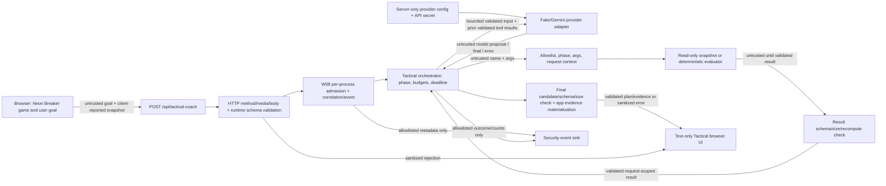

# Implementation Plan: Secure the Arcade — Neon Tactical Coach Security Hardening

**Branch**: `week8/secure-the-arcade` | **Date**: 2026-10-27 | **Spec**: [spec.md](spec.md)
**Input**: Accepted Week 8 feature specification at `specs/004-secure-the-arcade/spec.md`
**Baseline**: `e0ef30a1eddc9583a9894b79e10d53424d9f0b2a`; baseline typecheck, 287 tests, client build, and server build passed before W08 documents. This plan does not report W08 implementation or test results.

## Summary

Harden the existing advisory Neon Tactical Coach path, especially aggregate HTTP admission, bounded provider output, minimal security events, production browser policy, and adversarial proof. Preserve the two read-only tools, validated client-reported snapshot, application-materialized evidence, normal W05 fake flow, Week 4 Hint, and gameplay. Use deterministic fake-first tests and a small real-browser production-profile harness. See [research.md](research.md), [data-model.md](data-model.md), [contracts/security-boundaries.md](contracts/security-boundaries.md), and [quickstart.md](quickstart.md).

## Technical Context

**Language/Version**: Node.js v24.21.0, npm 11.19.0; TypeScript backend and vanilla JavaScript browser client
**Primary Dependencies**: `@google/genai` 2.24.0 locked; Vite 7.3.6 and TypeScript 7.0.2 installed for development/build
**Storage**: No application database, persisted Tactical game ledger, login/session store, or private-resource store; in-memory game in browser and request-scoped server state
**Testing**: Node `--test` under `npm test`; existing custom DOM stub; planned minimal Playwright dev-only real-browser checks for T04/T05/T16
**Target Platform**: Local macOS development, loopback Node API, Vite dev/production-preview browser profile
**Project Type**: Single repository browser game plus local TypeScript HTTP API
**Performance Goals**: Existing 5 s per provider attempt/22 s total deadline; at most two active and five new Tactical admissions per rolling 60 s per local process
**Constraints**: No real key/live Gemini in adversarial suite; no auth/database/leaderboard; read-only AI; no large refactor; exact W05 contracts preserved
**Scale/Scope**: One local process and one browser-style game, not a distributed public deployment

## Constitution Check

**Pre-research gate: PASS for this separately authorized Week 8 scope.** The constitution explicitly governs historical Week 4 work; its security, validation, fake-first, bounded reliability, regression, evidence, and change-discipline principles are applied here without rewriting Week 4 scope or history. The accepted Week 8 spec authorizes the focused Tactical hardening. No new AI capability, login, database, or deployment is planned.

| Principle/gate | Planning decision |
| --- | --- |
| Small scope and architecture | Keep browser → own API → server-side provider; change only affected Tactical/API/preview boundaries and tests. |
| Secrets and validation | Server environment owns key; exact request/tool/final contracts and sanitized public responses remain; synthetic secrets only in tests. |
| Fake-first and bounded reliability | T00–T17 use fake/stub providers; retain one app retry, 4 attempts, 5 s per call, 22 s total. No live Gemini adversarial dependency. |
| Regression and evidence | Keep gameplay, Week 4 Hint, and W05 Tactical positive path; record commands/checkpoint and actual outcomes later. |
| Change discipline and pair review | Elena/Isidora each own one protection and one negative test, cross-review each other's boundary, and record actual contributions later. |

**Post-design gate: PASS as a design.** Phase 1 contracts below do not introduce a third tool, write-capable action, auth resource, real secret, or incompatible interface. Delivery remains gated on future negative tests, real-browser proof, dependency findings, regression, and evidence; these have not yet run.

## Project Structure

### Documentation (this feature)

```text
specs/004-secure-the-arcade/
├── spec.md
├── checklists/requirements.md
├── plan.md                  # This phase
├── research.md              # Phase 0 decisions
├── data-model.md            # Phase 1 security state
├── contracts/
│   └── security-boundaries.md
└── quickstart.md            # Planned validation/run guide
# tasks.md belongs to a later phase and is not created now
```

### Source Code (repository root)

```text
server/
├── index.ts                  # Tactical HTTP admission, response policy, events
└── tactical/
    ├── contracts.ts          # Existing request/snapshot/final contracts
    ├── provider-contracts.ts # Provider outcome contract
    ├── tools.ts              # Existing two-tool registry/context/result validation
    ├── orchestrator.ts       # Existing state/budgets/deadlines; outcome bound if needed
    ├── fake-provider.ts      # Deterministic test adapter
    └── gemini-provider.ts    # SDK output/retry/token alignment
src/
├── main.js                   # Browser game and Coach input
├── tactical-snapshot.js      # Client-reported summary derivation
└── tactical-ui.js            # Existing text-only render and stale-response guard
tests/
├── tactical-api.test.js      # Existing HTTP tests; planned admission/event cases
├── tactical-orchestrator.test.js
├── tactical-tools.test.js
├── tactical-gemini-provider.test.js
└── tactical-ui.test.js       # Existing DOM-stub regression
vite.config.js                # Dev proxy; planned local preview proxy/security headers
package.json / package-lock.json # Add browser dev harness only if selected in later tasks
```

**Structure Decision**: Extend the existing flat browser + TypeScript API layout. A separate browser test file/config may be added later; no new application service layer or storage is required.

## Audited request path and trust boundaries



Trust boundaries: browser → HTTP is untrusted; provider/model → orchestrator is untrusted; model tool name/arguments → application execution is untrusted; tool result → provider/final validation remains untrusted until checked; validated response → browser DOM must stay text-only. `goal` and `state` originate in the browser, not a server ledger. Provider config and secret enter only the server adapter. Errors and logs are separately minimized; no raw goal/state/provider output belongs in operational events. Existing flow is in `server/index.ts`, `server/tactical/*`, `src/main.js`, and `src/tactical-ui.js`.

## Data inventory

| Data | Controller / source | Validation or boundary | Goes to model? | Stored? | Security note |
| --- | --- | --- | --- | --- | --- |
| `goal` | Player/browser | Exact request parser; 1–240 Unicode points | Yes, as goal text | Request duration and bounded provider history only | Prompt injection channel; never raw operational log. |
| Tactical `state` | Browser game summary | `parseTacticalSnapshot`, ranges and count equations | Yes, as validated snapshot tool result | Request scope only | Validated, not proof of played match. |
| score/lives/bricks/zones, ball, shield, portal | Browser-derived game fields | Exact snapshot schema, consistency checks | Selected bounded facts via tool | Request scope | No authoritative ranking or privilege. |
| Provider mode/model | Server env/fixed adapter | `TACTICAL_AI_PROVIDER` server factory; fixed model constant | No selection field from browser | Process config | Week 4 provider mode remains independent. |
| Gemini API key | Server environment | Adapter configuration only | No | Process environment/client instance | Never browser, response, model content, test evidence, or log. |
| Provider/model output | Remote model or fake | W08 earliest post-SDK size check; existing proposal/final parsers | Subsequent validated tool context only | Bounded adapter history for one run | Treat as hostile, not authority. |
| Tool name | Model proposal | Exact two-name allowlist plus phase | Declaration yes; proposal remains model-origin | Run scope | Reject `constructor`, `toString`, forbidden names. |
| Tool arguments | Model proposal | Exact snapshot/evaluator schemas before execution | Via validated tool-call history if needed | Run scope | No model-supplied context selector. |
| Tool result | Application tool/executor | Schema, ≤8192 bytes, evaluator recomputation | Yes, after validation | Run scope | Reject extra secret field before forwarding. |
| Final plan | Model | Exact schema, accepted candidate match, ≤4096 bytes | No subsequent model step | HTTP response/current UI | Natural-language text remains inert. |
| Materialized evidence | Application from validated tools | Fact allowlist/type/reference check | No subsequent model step | HTTP response/current UI | Values are not model-authored. |
| HTTP error | Server | Fixed public code/message mapping | No | Response only | No raw exception/stack/provider data. |
| Correlation ID | Application-generated | Generated before event; bounded fixed format | No | Request and event lifetime | Never client-supplied authority. |
| Security event | Server | Explicit metadata allowlist | No | Minimal operational sink | No raw goal/state/output/key/token/stack; newline injection inert. |
| Synthetic secret sentinel | Test-only server environment/injected failure | Negative boundary checks | Never intentionally | Test fixture only | Must be absent from build/source map, response, model context, log. |
| URL/localStorage | Browser URL is page/API path; no Tactical localStorage | Existing relative `/api` path; server pathname routing | No arbitrary URL | No observed Tactical localStorage | No arbitrary resource fetch or stored game session observed. |

## Existing W05 controls — verified in code

| Control | Evidence / enforcement location |
| --- | --- |
| Exact request, goal and state validation | `server/tactical/contracts.ts`: exact own-field objects, goal 240 Unicode points, snapshot ranges and score/count consistency. |
| HTTP body/media/method boundary | `server/index.ts`: Tactical POST, JSON media, 4096-byte read, validation before provider factory. |
| Server-owned provider choice | `server/index.ts`: `TACTICAL_AI_PROVIDER` selects fake or Gemini; browser provider field rejected by exact request parser; unknown mode fails safely. |
| Fixed run budgets/retry | `server/tactical/orchestrator.ts`: 3 steps, 2 tools, 4 provider attempts, 5 s per call, 22 s deadline, one transient retry and action tracker. |
| Closed read-only tools/context | `server/tactical/tools.ts`: only snapshot/evaluator declarations, exact name dispatch, validated frozen request context. |
| Tool args/result/recompute | `server/tactical/tools.ts` and `contracts.ts`: exact args, typed result, 8192-byte bound, fresh deterministic evaluator comparison. |
| Final plan/evidence | `server/tactical/contracts.ts` candidate match and evidence-reference validation; orchestrator materializes values from validated results and caps success body. |
| Text UI/stale response | `src/tactical-ui.js`: fixed DOM elements with `textContent`, public response parser, AbortController and generation guard. |
| Cancellation/deadline/sanitized errors | `server/index.ts` abort on disconnect and fixed HTTP bodies; orchestrator per-call abort, total checks, fixed public error map. |

These existing controls require explicit W08 adversarial regression proof; this table is code inspection, not a claim that T00–T17 have passed.

## Confirmed W08 gaps and implementation locations

| Gap confirmed by code review | Planned location / narrow change |
| --- | --- |
| No aggregate Tactical active-run or arrival-rate admission | `server/index.ts` or a small Tactical admission module called there, scoped to `createApiServer` instance. |
| No generated correlation ID or minimal security-event schema/sink | Tactical HTTP boundary and completion path, with allowlisted metadata only. |
| No normalized provider-outcome byte cap before proposal/final processing | `server/tactical/gemini-provider.ts` and a common orchestrator boundary for fake/injected outcomes. |
| Gemini adapter does not set output-token or explicit retry options | `server/tactical/gemini-provider.ts`, informed by installed SDK types; avoid hidden extra attempts. |
| No local production preview proxy/header profile | `vite.config.js` preview configuration, tested against built assets. |
| No real-browser CSP/XSS harness | Small dev-only browser harness and T04/T05/T16 cases; existing DOM-stub suite stays. |
| No W08 adversarial/security-event/sentinel tests | Focused additions to Tactical API/tools/orchestrator/provider tests plus browser harness. |
| No W08 dependency audit evidence | Later evidence run against `package-lock.json`; no remediation during planning. |

## Complexity Tracking

No constitution violation is required. The only anticipated new test dependency is a minimal real-browser harness for browser/CSP claims that the existing DOM stub cannot prove.

## Threat model

Likelihood is a qualitative local/demo judgment about attacker reachability; impact describes the consequence if the boundary fails. None of these entries claims a demonstrated W08 exploit.

### R1 — Direct HTTP and privilege-field bypass

- **Scenario/prerequisite**: A caller reaches the loopback Tactical endpoint directly, bypasses the browser form, and submits malformed or extra `provider`, `maxSteps`, `ownerId`, or `role` fields.
- **Trust boundary / protected asset**: Browser-controlled HTTP bytes → server policy and provider budget; protect predictable API capacity and server-owned configuration.
- **Likelihood rationale**: High for a local process/user able to send HTTP directly; browser validation is trivially bypassed.
- **Impact rationale**: Medium–high if extra fields alter policy or malformed input starts provider work; otherwise bounded rejection.
- **Existing W05 control**: Method/media/body checks before provider and exact `goal,state` parser in `server/index.ts` and `contracts.ts`.
- **W08 gap**: Direct adversarial matrix with separated size vs privilege cases and observed zero-work counters is not yet present.
- **Planned enforcement / proof**: Preserve HTTP/parser boundary; T01 tests malformed JSON/type/domain and positive edge, T02 tests body limit and privilege variants separately with provider/tool counters.
- **Residual limitation**: No authenticated caller identity is created; a valid direct request is still allowed, subject to admission policy.

### R2 — Agent/tool authority escalation

- **Scenario/prerequisite**: A hostile goal and/or provider proposes unknown, forbidden, prototype-named, repeated, out-of-phase, invalid-argument, or foreign-context tool action.
- **Trust boundary / protected asset**: Model-authored name/arguments → application-controlled tool execution; protect canonical game and request-scoped data.
- **Likelihood rationale**: Medium–high because goals and model output are untrusted even with a well-intended model.
- **Impact rationale**: High if arbitrary function dispatch or cross-request snapshot access occurs; no such capability is intended.
- **Existing W05 control**: Two-name registry, exact args/context, phase checks, action tracker, result validation and evaluator recompute in Tactical tools/orchestrator.
- **W08 gap**: Explicit `constructor`/`toString`, schema-valid scope, and malicious-goal-plus-malicious-fake-provider cross-boundary proof.
- **Planned enforcement / proof**: Prefer tests against existing dispatch; change code only for a demonstrated gap. T03, T07–T11 and combined T17 include positive allowed-tool control.
- **Residual limitation**: Fake-provider tests establish app execution policy, not universal real-Gemini resistance to prompt injection.

### R3 — Browser content injection

- **Scenario/prerequisite**: Model final text, materialized display text, or goal-like user input contains script/HTML/Markdown/link payload.
- **Trust boundary / protected asset**: Untrusted text → browser DOM and navigation; protect player browser execution context.
- **Likelihood rationale**: Medium: the existing output schema allows natural-language strings, and a hostile provider or prompt can supply them.
- **Impact rationale**: High if active script or `javascript:` navigation is created; ordinary text rendering is safe.
- **Existing W05 control**: `src/tactical-ui.js` uses `textContent` and exact public response validation; no rich-text renderer is observed.
- **W08 gap**: No real-browser XSS/link test or delivered production CSP/header proof.
- **Planned enforcement / proof**: Keep text-only contract; production preview CSP and real-browser T04/T05/T16. Use controlled available cross-origin script and observed `script-src` block, never a 404 proxy.
- **Residual limitation**: Local preview profile is not a public deployment configuration; future hosting must preserve equivalent headers.

### R4 — Resource exhaustion

- **Scenario/prerequisite**: Direct callers submit simultaneous or repeated valid Tactical requests; each run can consume provider attempts.
- **Trust boundary / protected asset**: Valid HTTP arrivals → aggregate provider/server capacity and responsive gameplay.
- **Likelihood rationale**: High for anyone able to reach the local port; UI disabled state is irrelevant to direct requests.
- **Impact rationale**: Medium–high because per-run budgets do not limit aggregate concurrent/rate cost.
- **Existing W05 control**: 4096-byte body and 3-step/2-tool/4-attempt/5 s/22 s per-run bounds.
- **W08 gap**: No active-run cap or rolling admission rate in `server/index.ts`.
- **Planned enforcement / proof**: Per-server-instance 2 active/5 admitted per rolling 60 s gate after input validation and before provider factory; T13 tests concurrency and rate separately plus recovery, T11/T12 test per-run exhaustion/cleanup.
- **Residual limitation**: In-memory one-process counts do not coordinate multiple processes or public deployment; no client identity fairness is claimed.

### R5 — Secret and log leakage

- **Scenario/prerequisite**: A provider error, extra tool field, or newline/fake-event goal text reaches response/model/log handling; test-only server key sentinel is present.
- **Trust boundary / protected asset**: Server-only config and untrusted strings → HTTP/browser/model context/operational events; protect secret and event integrity.
- **Likelihood rationale**: Medium: provider errors and free text are ordinary failure/input channels, even without real credentials in tests.
- **Impact rationale**: High for actual key leakage or forged audit events; local demo narrows audience but not the need to prevent it.
- **Existing W05 control**: Server-side key lookup, fixed public error map, exact tool result parsing, app materialization; no raw exception intentionally returned.
- **W08 gap**: No minimal structured Tactical security-event model or sentinel/log-injection tests; production bundle/source-map boundary not checked.
- **Planned enforcement / proof**: Allowlisted admission/rejection/completion events at HTTP boundary; T10/T14/T16 inspect model calls, responses, bundles/source maps, and event sink with synthetic sentinel and fake-newline content.
- **Residual limitation**: Third-party provider/SDK internal logging is outside this app's observable operational event sink; do not claim proof for unseen infrastructure.

### R6 — Forged client game state

- **Scenario/prerequisite**: Caller constructs a schema-valid but unplayed score/brick/snapshot combination and requests coaching.
- **Trust boundary / protected asset**: Browser-derived game summary → Tactical functional advice; protect authority boundaries and any future confirmed result interpretation.
- **Likelihood rationale**: High because all game state is client-reported and a direct caller can manufacture valid JSON.
- **Impact rationale**: Low for advisory-only current Coach, high if later mistaken for ranking/privilege authority.
- **Existing W05 control**: Exact range/count/score consistency checks; tools receive only validated request-scoped snapshot and never mutate game.
- **W08 gap**: No explicit forged-valid evidence showing limited scope and no authoritative promotion, including combined prompt/tool attempt.
- **Planned enforcement / proof**: Retain unverified-state semantics; T03/T15/T17 prove no resource selector, authority expansion, or canonical game mutation.
- **Residual limitation**: The server still cannot prove physical play without a separate trusted game ledger, which remains out of scope.

**Top three for implementation priority**: R4 first because aggregate work is an observed missing server control with direct cost; R3 second because browser script execution has high impact and currently lacks real-browser/CSP proof; R2 third because the model/tool boundary is the core AI capability boundary, so its existing controls need aggressive regression even if code change is unnecessary. R5 remains high-impact and receives concurrent event/sentinel work.

## Server admission and event design

1. Validate method/media/body/JSON and exact Tactical request before provider construction. Apply any genuinely applicable origin rule before provider work. A malformed request returns a fixed public error with zero provider/tool attempts; count its minimal rejection event without retaining raw body.
2. For a valid request, check the rolling 60 s accepted-admission timestamps against five; then check two active slots, as one atomic synchronous decision in the server instance. Rejection consumes no provider/tool work and does not count as admitted. State uses server time and an injectable fake clock in tests, not `ownerId`, IP-as-auth, or other client identity.
3. On acceptance, generate a bounded correlation ID and reserve one active slot before calling the provider factory/orchestrator. Record an allowlisted admitted event. A separate rejected event records only category/reason and zero attempts. Exact public status/error mapping is specified in [contracts/security-boundaries.md](contracts/security-boundaries.md).
4. Release the active slot exactly once in `finally` on success, safe failure, timeout, caller abort, or disconnect; emit completion with bounded counters/outcome. Do not hold a slot while only reading an invalid body. A late provider promise must not produce a second completion or success. Confirm recovery after a slot frees and after the rolling window expires with deterministic fake clock/provider and direct HTTP tests.
5. Event schema is an explicit metadata allowlist: `event`, timestamp, app-generated `correlationId`, fixed `reasonCode`, fixed `outcome`, `providerAttempts`, `executedToolCalls`; optional bounded active/admitted counts if useful. Counts mean actual provider-generate attempts and tool-executor invocations, including an invocation whose result is later rejected; they are not merely successful validations. Never serialize the HTTP request, provider exception, raw state/stats, goal, token/cookie, API key, chain-of-thought, or stack. T14 sends newline/fake-event content and asserts exactly the genuine event sequence, without a forged record.

The policy protects one local process. It does not claim distributed fairness or public-production rate limiting. Slot and rate tests must be separate: a full rate window can mask concurrency recovery, and a full active set can mask rate recovery.

## Provider and Gemini adapter design

**2026-10-28 observed correction:** A `thoughtSignature` is SDK-returned metadata retained verbatim in the adapter's model history; normalized proposal bytes do not include it. The adapter now rejects signatures above **8192 UTF-8 bytes** before retention and checks the serialized next model-facing request against **16384 UTF-8 bytes** before each SDK call. The counted object includes model, `contents`, system instruction and generation config (tool declarations or response schema); transport signal/retry options are excluded. The measured normal three-step requests were **1053/2003/4360 bytes**, leaving headroom; two individually allowed 8192-byte signatures exceed the total and are rejected before the third SDK call. These application controls do not bound bytes already received by the SDK or remote processing. The separate raw-final, normalized-outcome, tool-result and final-response checks remain in force.

- **Installed SDK fact**: `@google/genai` 2.24.0 is in `package-lock.json` and `node_modules`. Local declarations expose `maxOutputTokens` and `httpOptions.retryOptions`. Local SDK implementation has one fetch when retry options are absent; the default multi-attempt behavior applies if retry options are supplied without an explicit attempt count. The current Tactical adapter supplies `abortSignal` and disables automatic function calling but supplies neither output-token nor retry options. Thus current app-visible retry count is the orchestrator's one transient retry, with no observed hidden SDK HTTP retry in this call path.
- **Retry decision**: Keep SDK retry options absent or explicitly one attempt, then add a stubbed contract test that inspects passed config. The app orchestrator remains the sole retry owner; its four-attempt counter must include every call to `provider.generate`. If SDK internals change on upgrade, re-audit local types/implementation and do not silently assume the count still maps to network attempts.
- **Output decision**: Set a server-owned `maxOutputTokens` value only after checking that a normal compact three-phase plan fits; this is a token-generation bound, not a byte proof. Measure the normalized provider outcome as serialized UTF-8 at the earliest application-controlled adapter/orchestrator boundary and enforce the spec's 8192-byte local cap before tool dispatch/final validation. For the final text, check byte length before `JSON.parse` where possible. Avoid retaining or logging the oversized content. The SDK has already received/parsed the remote HTTP response when `generateContent` resolves, so label this a post-SDK/application bound, never network-stream protection.
- **Abort/deadline**: `abortSignal` travels from HTTP controller through orchestrator attempt controller to SDK. The existing 5 s attempt and 22 s total checks continue to guard late results. Test both with controllable fake provider/scheduler; do not use live Gemini in adversarial cases.

## Browser, production profile, and CORS/CSRF

The audited app has external module JavaScript in `index.html`, bundled CSS, relative `/api` requests, no observed inline script requirement, no `innerHTML`/Markdown/linkification in Tactical UI, and no Tactical localStorage. Development Vite `server.proxy['/api']` maps the browser's same-origin path to loopback `127.0.0.1:3001`; its config does **not** currently specify `preview.proxy` or delivered security headers. Node API itself returns JSON Content-Type only and listens on loopback. No cookie, auth header, bearer token, or ambient privileged credential is observed in this route.

**Local production profile**: Configure Vite `preview.proxy['/api']` explicitly and deliver real response headers in the preview path, then build with `npm run build` and browse the built app via preview with the loopback API running. Candidate policy from actual assets: `default-src 'self'; script-src 'self'; object-src 'none'; base-uri 'none'; frame-ancestors 'none'; style-src 'self'; img-src 'self' data:; connect-src 'self'`. Include `X-Content-Type-Options: nosniff` and a restrictive `Referrer-Policy` (for example `strict-origin-when-cross-origin` or stronger). First inspect the built HTML/CSS/JS; if a directive conflicts with a required asset, justify the narrow adjustment rather than adding arbitrary `unsafe-eval` or `unsafe-inline`.

**Controlled T16 proof**: Start a local controlled script endpoint on another loopback origin. Verify it returns 200 and sets a marker when loaded in a no-CSP control page. In the production preview page attempt to load the same accessible script, capture the browser CSP violation naming `script-src`, and assert the marker remains unset. A 404, wrong URL, or script that could never execute is not proof. Also inspect actual headers and ensure game rendering, normal Coach flow, and relative `/api` requests work.

**Real-browser harness**: Plan a minimal `@playwright/test` development dependency and small browser config/test file; no installation occurs in this planning step. Node DOM-stub tests remain for fast contract checks, but they cannot prove browser execution or delivered CSP. Limit Playwright scenarios to T04/T05/T16 and a positive W05 smoke path. Start built preview and API via documented local commands or test-managed processes; assert DOM text, zero script marker, benign Serbian/apostrophe/`a < b` text, no active injected links, response headers, and CSP violation. Use fake Tactical mode for deterministic Coach output; no Gemini key. A browser binary/setup prerequisite and local listener permission are documented in [quickstart.md](quickstart.md).

**CORS/CSRF decision for this architecture**: Privileged CSRF is not applicable while the route has no ambient credential or privileged private resource. This is conditional on the audited current profile and must be re-evaluated if cookies/auth are introduced. Development and planned local preview use a relative same-origin `/api` path with server-side proxy, so no cross-origin browser API permission is needed. Do not add broad `Access-Control-Allow-Origin`. If the serving topology later separates frontend and API origins, define an explicit allowed-origin/credentials policy for that topology. CORS is not authentication, and CSRF non-applicability does not excuse direct-request rate/resource limits.

## Dependency audit and evidence plan

`package-lock.json` is the locked resolved graph; `package.json` distinguishes runtime `@google/genai` from dev Vite/TypeScript/types. In the implementation/evidence phase, record Node/npm versions, lockfile checkpoint, `npm audit --package-lock-only --json` (or the equivalent supported command), and a runtime-only view such as `npm audit --package-lock-only --omit=dev --json`. Preserve each finding's package, locked/installed version, advisory ID/link, actual exposure in this local project, decision (`fixed`, `mitigated`, `demonstrated not applicable`, `open risk`), and residual risk. If registry/network access prevents the audit, record command/error and uncertainty. Never use `npm audit fix --force` blindly. If a relevant dependency changes later, rerun typecheck, tests, client/server builds, and affected browser scenarios. A clean audit does not establish application boundary security. No audit or remediation is claimed in this planning phase.

## Official T00–T17 implementation and test mapping

| ID | Main boundary | Test type | Planned location | New control needed? |
| --- | --- | --- | --- | --- |
| T00 | Normal game → W05 Tactical read-only flow with ≥2 model steps, ≥1 actual allowed tool call, valid plan, no game mutation | Positive fake integration/browser smoke | `tests/tactical-api.test.js`, browser harness | No core flow change; regression proof. |
| T01 | Invalid direct HTTP → provider/tool zero work | HTTP negative + positive edge | `tests/tactical-api.test.js` | Existing parser; expand counters/fixtures. |
| T02 | Body limit and server-owned privilege fields | Separate HTTP size/field tests | `tests/tactical-api.test.js` | Existing checks; explicit proof. |
| T03 | Request-scoped snapshot, no foreign resource | Contract/tool context test + HTTP extra-selector | `tests/tactical-api.test.js`, `tests/tactical-tools.test.js` | Existing scope; explicit proof. |
| T04 | Model/user text → real DOM | Real browser XSS marker | New browser security test | Production harness; no rich-text implementation. |
| T05 | HTML/Markdown/link text-only policy | Real browser DOM/navigation | New browser security test | Usually existing `textContent`; proof. |
| T06 | Provider invalid/oversized outcome | Fake/stub provider negative | `tests/tactical-orchestrator.test.js`, `tests/tactical-gemini-provider.test.js` | New post-SDK/outcome size bound. |
| T07 | Unknown/forbidden/prototype tool names | Tool/orchestrator unit negative | `tests/tactical-tools.test.js`, `tests/tactical-orchestrator.test.js` | Existing allowlist; proof/fix only if gap. |
| T08 | Args and current-context scope | Tool unit negative + positive | `tests/tactical-tools.test.js` | Existing context validation; proof/fix only if gap. |
| T09 | Malicious goal → malicious fake proposal | Fake integration negative | `tests/tactical-orchestrator.test.js` | Existing execution policy; explicit cross-boundary proof. |
| T10 | Invalid/large/secret tool result → model | Fake tool executor/call-history test | `tests/tactical-orchestrator.test.js`, `tests/tactical-tools.test.js` | Existing result parser; proof/fix only if gap. |
| T11 | Repeated action and total budgets | Fake scheduler/provider unit tests | `tests/tactical-orchestrator.test.js` | Existing tracker/counters; separate proof. |
| T12 | Per-call/total deadline and late cleanup | Fake clock/provider + HTTP cancellation | `tests/tactical-orchestrator.test.js`, `tests/tactical-api.test.js` | Existing deadline plus new slot-release integration. |
| T13 | Concurrent HTTP and separate rate window | HTTP fake provider/clock integration | `tests/tactical-api.test.js` or focused admission test | New per-process admission gate. |
| T14 | Sentinel and newline/fake event | Fake error/result + event-sink tests | `tests/tactical-api.test.js`, provider/tool tests | New minimal event boundary; existing public sanitization. |
| T15 | Forged-valid client state | Direct HTTP/game-state test | `tests/tactical-api.test.js`, `tests/tactical-snapshot.test.js` | Existing unverified-state contract; proof. |
| T16 | Built client, delivered CSP/headers, real block | Build inspection + real browser | New browser security test | New preview profile and sentinel proof. |
| T17 | Forged state + malicious goal + forbidden proposal | Combined fake HTTP/tool/event integration | `tests/tactical-api.test.js` or focused security integration | Combine existing tool boundary and new event observations. |

T13 concurrency and rate use separate subcases and separate recovery assertions. T17 is the extra threat-model scenario, not a rename of a regression test. T04/T05/T16 require real browser observation; fake/DOM-stub tests alone are insufficient.

## Comparable pre/post evidence

Use the immutable W05 checkpoint `e0ef30a1eddc9583a9894b79e10d53424d9f0b2a` for before observations and a recorded W08 implementation checkpoint for after observations. Run the same fixture/input and environment profile on both; do not deliberately introduce a vulnerability. Where a new test harness cannot run unchanged against the old checkpoint, record the harness adaptation separately rather than calling the results equivalent.

| Scenario | Same fixture/input and expected before | Planned after observation | Proves / does not prove |
| --- | --- | --- | --- |
| P1 — aggregate concurrency | Same valid Tactical request and held fake provider, with three simultaneous direct HTTP callers. W05 code has no aggregate gate; expected all can reach provider, to be measured rather than assumed as an observed result. | At most two active; third receives safe admission rejection with zero provider work; after release a valid request succeeds. Separate five/60 s rate case also recorded. | Proves local per-process admission and recovery; not distributed or public abuse protection. |
| P2 — production CSP/headers | Same built UI and controlled accessible script URL. W05 preview config has no declared production header profile; measure actual delivered headers and marker behavior at the before checkpoint. | Headers present; controlled URL returns 200 but production CSP blocks it, emits violation, marker stays unset; game/Coach work. | Proves the tested local preview browser profile; not every future hosting environment or arbitrary XSS payload. |
| P3 — existing tool authority | Same scripted `constructor`/`toString` and malicious-goal fake proposal against allowlisted tool boundary. W05 code already has exact-name dispatch, so expected safe rejection; measure calls and state. | Safe rejection remains; W08 tests make the proof explicit and include combined T17 context/event observations. | Proves application dispatch preservation; not universal real-Gemini prompt-injection resistance. |

`EVIDENCE_W08.md` later records expectations before runs, exact commands/checkpoints, observed values, failures, and separate inferences. A prior assumption is never rewritten as an observation.

## Planned pair ownership and review

| Contributor | Primary scenarios | Protection/design ownership | Required negative test and review |
| --- | --- | --- | --- |
| Elena | T01–T05, T13–T16, dependency audit/evidence | HTTP admission and minimal event boundary; local production preview CSP/headers and browser harness | Direct HTTP excess/privilege rejection, browser malicious text/CSP block, secret/log injection; Isidora reviews server and browser security evidence. |
| Isidora | T06–T12, T17 | Provider output/retry/token alignment; tool/orchestrator defense only if audit/test reveals a real gap | Oversized provider output, forbidden tool, wrong context, retry/deadline tests, combined T17; Elena reviews adapter/tool changes and negative evidence. |
| Joint | T00, threat model, integration, `EVIDENCE_W08.md`, demo | Final regression and runbook | Both review the complete diff, results, residual limits, and one another's tests; planned ownership is not a claim of completed contribution. |

The distribution gives each person at least one protection and one negative test. The final evidence must report actual driver/reviewer work and any reassignment, not copy this plan as if completed.

## Sequential execution waves and future quality gates

The accepted specification and planning artifacts precede implementation. T001 has recorded the real W05 before checkpoint; T002–T055 remain future work. Task IDs are coverage identifiers, not an instruction to alternate contributors. The technical halves execute in order: Elena completes and hands off a stable pushed branch, Isidora works from that exact handoff, then both integrate and prepare evidence. This corrects workflow only; the official T00–T17 meanings, I1–I8, budgets, trust model, and security controls above do not change.

### Wave A — Elena technical half

Elena prepares the shared T002 fixture before handoff (its `[Joint]` ownership remains shared), then completes T003, T005, T007, T008, T009–T011, T016, conditional T018, T023–T026, T031–T034, T036–T040, T043, and conditional T044. Her HTTP/browser/admission work uses the existing W05 Tactical fake/stub and provider behavior; it does not wait for Isidora's W08 adapter/orchestrator implementation. Elena's dependency chains are `T005 → T009/T010/T011/T016 → conditional T018`; `T007 → T008 → T036/T037 → T038 → T039 → T040`; and `T005 → T023/T024/T025/T026 → T031/T032 → T033/T034`. Specifically, T031 depends on T023, T032 on T024, T033 on T025 plus T031/T032, and T034 on T026. After T007 settles the lockfile, T043 precedes conditional T044. A non-applicable T044 does not force an upgrade.

**Elena handoff gate — `ELENA HALF COMPLETE — READY FOR ISIDORA HANDOFF`**: Run her relevant security tests, affected regressions, `npm run typecheck`, full `npm test`, `npm run build`, `npm run build:server`, and the browser suite that actually exists. Review `git diff --check` and `git status`; verify fake-only testing, no live Gemini calls, and no real key. Resolve observed failures in her lane, then make a stable non-force commit/push and record its actual SHA for later evidence. Isidora starts only after this gate; no handoff SHA or PASS is asserted now.

### Wave B — Isidora technical half

Starting from Elena's pushed handoff, Isidora reviews/uses T002 and completes T004, T006, T012–T015, conditional T017, T019–T022, T027–T029, conditional T030, T042, and T052. Her chains are `Elena handoff → T004/T006`; `T006 → T012/T013/T014/T015 → conditional T017`; and `T006 → T019/T020/T021/T022 → T027/T028/T029/conditional T030`. T027/T028 follow the relevant T019 normal-envelope/output cases, T029 follows T021/T022, and T030 follows T020–T022 only if a gap appears. Elena's completed handoff is the only cross-lane prerequisite; she need not resume work between these steps. T042 combines her tool/provider controls with Elena's already committed admission/event controls. T052 reviews an actually completed Elena HTTP/browser negative test and leaves a review note for joint evidence.

**Isidora handoff gate — `ISIDORA HALF COMPLETE — READY FOR JOINT INTEGRATION`**: Run her relevant tool/provider/agent/T17 tests, affected regressions, typecheck, full tests, client/server builds, and review `git diff --check` plus `git status`. Confirm fake-only testing and no real key, resolve observed failures in her lane, then make a stable non-force commit/push and record its actual SHA. No gate result or SHA is asserted in this plan.

### Wave C — joint integration and evidence

After both handoffs, execute T035, T041, T045–T051, and T053–T055. T052 is Isidora's Wave B review of Elena's finished work; T051 is Elena's review of Isidora's finished work. T035/T041 first confirm the positive W05/game/browser path and permit only a minimal integration fix if a real regression demands one. Then run the three same-fixture before/after comparisons, complete the official T00–T17 matrix, write `EVIDENCE_W08.md` with both actual handoff SHAs and actual Elena/Isidora/AI contributions, review the final diff/security boundaries, run final quality gates, and rehearse the eight-minute demo. Planned activity is never recorded as observed; affected checks repeat after any integration fix.

**Stop boundary for this workflow correction**: Update only `plan.md` and `tasks.md` to define the sequential handoffs. Do not execute T002–T055, install a dependency, edit source/tests/packages, create a commit, push, or call live Gemini in this correction step.

## Open risks and unknowns for later proof

- SDK output-token setting needs a concrete value that preserves normal plans. Local installed types support the field, but byte protection remains post-SDK.
- Preview proxy/header behavior and candidate CSP directives need empirical local production-build confirmation. The Vite type surface alone is not a delivered-header test.
- Browser binary availability and local listener permissions for the later Playwright harness are unverified. The harness must document setup without making Node unit tests depend on a live browser.
- Dependency advisories and exposure cannot be concluded until a later audit against the actual lockfile; registry access may block the run.
- Existing W05 controls are code-confirmed but T00–T17 adversarial claims still need execution. No result for real Gemini's universal behavior is possible from fake tests.
- If serving changes to cross-origin or adds ambient credentials, the CORS/CSRF decision must be revisited; current conclusion applies only to the audited local/demo path.
